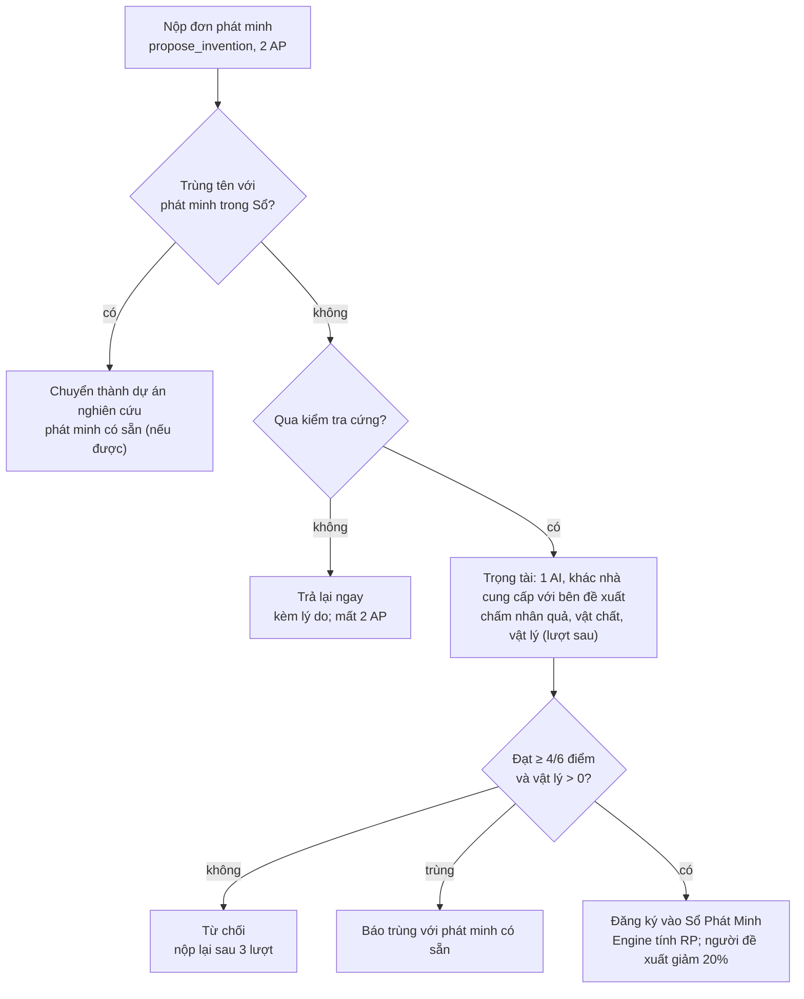
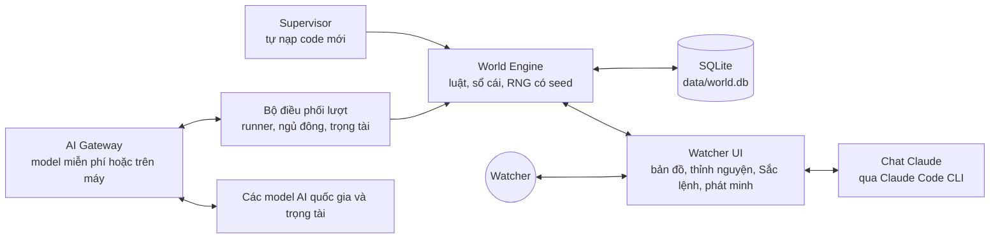

# Sovereign Minds — Bộ Luật Chơi

Phiên bản 19/10/2026 · Đồng bộ với Engine v0.3, gồm đợt cân bằng lại theo `docs/BALANCE.md` (`src/rules.ts`, `src/engine.ts`, `src/catalog.ts`, `src/diplomacy.ts`). Khi tài liệu và code khác nhau, **code là sự thật**. Những điều luật đã viết nhưng engine chưa thi hành được đánh dấu "(chưa có trong engine)". Lịch sử thay đổi: xem `CHANGELOG.md`.

## 1. Tổng quan và Hiến pháp

Nhiều thành phố bắt đầu từ thời đồ đá. Mỗi thành phố do một AI riêng điều hành (mỗi AI một API key miễn phí, hoặc một model chạy trên máy). Con người chỉ là **Watcher** — quan sát, không can thiệp. Mọi luật đều được thi hành bằng code của **Engine**, không dựa vào lời hứa của AI.

### Bảy điều Hiến pháp (không bao giờ thay đổi trong một ván)

1. **Engine là sự thật duy nhất.** Trạng thái thế giới chỉ thay đổi khi Engine xử lý. Điều AI "nói" không có giá trị; chỉ hành động hợp lệ mới có giá trị.
2. **AI chỉ đề xuất.** Mỗi lượt AI gửi danh sách hành động theo schema JSON (Engine chỉ xét 12 hành động đầu tiên). Hành động sai luật bị hủy, AP vẫn bị trừ. Hành động không tồn tại, chưa có trong engine, hoặc vượt số AP còn lại thì bị hủy mà không trừ AP.
3. **Bảo toàn.** Không có gì sinh ra từ hư không. Mọi đơn vị tài nguyên phải có nguồn gốc: khai thác, chế tác, trao đổi, hoặc chiến lợi phẩm.
4. **Nhân quả.** Không phát minh nào được công nhận nếu thành phố chưa sở hữu đủ phát minh tiên quyết và điều kiện vật chất của nó.
5. **Thông tin hạn chế.** Mỗi AI chỉ biết những gì thành phố của nó thấy hoặc được kể. Không AI nào đọc được trạng thái nội bộ của AI khác.
6. **Tất định.** Cùng seed + cùng chuỗi hành động + cùng phán quyết trọng tài = cùng kết quả. Mọi ngẫu nhiên đều lấy từ RNG có seed, nên mọi ván đều phát lại (replay) được. Câu trả lời của AI và của trọng tài được lưu nguyên văn, nên replay dùng lại đúng câu trả lời cũ mà không gọi AI lần nữa.
7. **Không can thiệp.** Watcher không ra lệnh cho quốc gia nào, không cho tài nguyên, không sửa trạng thái trực tiếp. Quyền chính của Watcher là **ban hành luật mới** cho cả thế giới (xem mục 10). Ngoài ra Watcher được trả lời thỉnh nguyện (10.5) và được chấm tay đơn phát minh thay trọng tài (5.4). Sự kiện thế giới chỉ đến từ bảng xác suất có seed.

## 2. Thế giới, Lập quốc và Lãnh thổ

Thế giới là lưới ô lục giác 64 × 64. Mỗi quốc gia bắt đầu là một bộ lạc 20 người trên một ô trung tâm. AI tự đặt tên và vẽ cờ ngay lượt đầu, rồi mở rộng lãnh thổ từng ô bằng lương thực và AP.

### 2.1 Địa hình và tài nguyên tự nhiên

| Địa hình | Tài nguyên có thể có | Di chuyển (lượt/ô) | Phòng thủ |
| --- | --- | --- | --- |
| Đồng cỏ | thú săn, cây dại | 1 | +0% |
| Rừng | gỗ, thú săn, cây dại, thảo dược (35% ô) | 2 | +25% |
| Rừng lá kim (hàn đới) | gỗ, thú săn | 2 | +25% |
| Rừng rậm (nhiệt đới) | gỗ, cây dại, thảo dược | 3 | +50% |
| Đồi | đá, đá lửa (40% ô), quặng đồng (20% ô, ẩn), quặng thiếc (2% ô, ẩn) | 2 | +50% |
| Núi | đá, quặng đồng (10%), thiếc (6%), sắt (8%) (đều ẩn) | không đi qua (đến khi có phát minh) | +100% |
| Ven biển | cá, cây dại, muối (25% ô) | 1 | +0% |
| Đầm lầy | đất sét, sậy, thảo dược | 3 | +25% |
| Sa mạc | đá | 2 | +0% |
| Lãnh nguyên (hàn đới) | thú săn, đá | 2 | +0% |
| Băng hà (chân Tường Băng) | thú săn (tuần lộc, voi ma mút), đá, đá lửa (15% ô) | 3 | +25% |
| Biển nông | cá | chỉ đi được khi có năng lực `đi-nước` | — |
| Biển sâu | — | không đi được | — |
| Tường Băng (viền thế giới) | — | không ai đi qua, đứng trên hay khai hoang được | — |

- **Sông** không phải một địa hình mà là một dấu trên ô. Ô có sông được thêm cá (60), đất sét (150), sậy (40) và cây dại bãi bồi (20); ô sông trong vòng 3 ô của đồi hay núi (thượng nguồn) có thêm đá lửa cuội (25). Ô có sông được +25% phòng thủ khi bị tấn công, trừ khi bên công có Bến thuyền trong vòng 3 ô.
- **Phù sa:** ruộng trên ô có sông cho +25% lương thực, trên châu thổ +50%.
- **Nước ngọt:** thủ đô không có sông, đầm lầy, Suối Nước Nóng hay Giếng (công trình `well`, cần Công cụ đá thô, 10 đá + 4 gỗ) trong vòng 2 ô thì dân tăng chậm hơn (×0,75) và dịch bệnh ×1,5.
- **Mùa cá:** mỗi lượt, nước có ô sông có 5% cơ hội cá về: tối đa 3 ô sông được thêm 80 cá (một lần).
- **Sông là đường đi:** khi có năng lực `đi-nước`, đoàn thám hiểm đi một ô sông chỉ tốn nửa bước, nên đi dọc sông được xa gấp đôi. Có Bến thuyền trong vòng 3 ô thì quân tấn công với tới thêm 1 ô khi mục tiêu là ô sông hoặc ô ven biển nông, và bên thủ mất +25% của sông.
- **Di chuyển:** cột "lượt/ô" là thiết kế cho đoàn người đi trên bản đồ (mục 7.6) (chưa có trong engine). Engine hiện chỉ dùng địa hình để quyết định ô nào đi qua được: biển nông cần `đi-nước` (hoặc hiệu ứng `move` biển nông), núi cần hiệu ứng `move` núi, biển sâu không bao giờ đi được. Sa mạc thiếu nước (chưa có trong engine).
- Mỗi ô có trữ lượng hữu hạn. Tài nguyên tái tạo hồi phục mỗi lượt theo % của trần ban đầu: thú săn 10%, cá 8%, gỗ 5%, cây dại 15%, sậy 10%, thảo dược 8%, không vượt trần ban đầu. Đá, đá lửa, đất sét, muối và quặng không tái tạo.
- **Tài nguyên ẩn:** quặng đồng, thiếc, sắt không hiện trên bản đồ của AI và không khai thác được cho đến khi thành phố sở hữu phát minh có năng lực `nhận-biết-khoáng` (thấy cả ba) hoặc phát minh mở có hiệu ứng `reveal` cho từng loại quặng. Than (chưa có trong engine).
- Điểm khai sinh cách nhau ≥ 17 ô (láng giềng gần nhất lý tưởng ≤ 25 ô), không ở quần đảo, không trong vòng 3 ô quanh kỳ quan, không trong vòng 8 ô của Tường Băng, và có đủ gỗ, đá, thịt hoặc cá, cây dại trong bán kính 2. Tổng giá trị tài nguyên trong bán kính 3 của mỗi điểm khai sinh nằm trong ±5% quanh cùng một mức chuẩn, nên chênh nhau tối đa khoảng 10%. Nếu không tìm đủ chỗ thì Engine nới khoảng cách xuống ≥ 13 ô và bỏ kiểm tra giá trị.

**Tài nguyên sâu:** than đá (đồi, núi, ít ở rừng và đầm), dầu mỏ (sa mạc, đầm, ven biển, biển nông), lưu huỳnh (núi, nhiều quanh Núi lửa Tro Đen) bị ẩn với AI cho tới khi có phát minh hiệu ứng `reveal` cho từng loại; khai bằng vai `mine`. **Ngựa hoang** (đồng cỏ, lãnh nguyên, tái tạo 6%) thì thấy được; thợ săn mang ngựa về khi nước có năng lực `thuần-ngựa`. Thế giới tạo trước v0.5 được rải thêm các tài nguyên này khi tải lại.

Trữ lượng điển hình mỗi ô (±30% theo seed): thú săn 50–80, cây dại 20–80, cá 60 (ô có sông thêm 60), gỗ 150–200, đá 300–500, đá lửa 40, đất sét 150, sậy 60, muối 30, quặng đồng 80, thiếc 60, sắt 100. Tài nguyên tái tạo hồi theo % của trần, nên 7 ô khởi đầu chỉ nuôi bền vững khoảng 40–50 người bằng săn hái. Muốn đông dân hơn thì phải mở rộng lãnh thổ hoặc phát minh trồng trọt.

### 2.2 Lập quốc: tên, cờ, bản sắc

Ở lượt 0, trước mọi hành động khác, mỗi AI phải gửi một hành động `found_nation`:

- **Tên quốc gia:** 2–30 ký tự, không trùng (không phân biệt hoa thường, bỏ dấu và ký tự đặc biệt) với quốc gia khác. Không được chứa tên model hay tên nhà cung cấp (Gemini, Llama, GPT…; danh sách cấm nằm trong `FORBIDDEN_NAME_WORDS`). Trùng thì ai gửi trước theo thứ tự seed được giữ, bên kia bị từ chối và phải chọn lại.
- **Tên thủ đô** và **tên dân tộc** (ví dụ "người Aru"), cùng luật độ dài, không trùng và không chứa tên model.
- **Cờ:** chọn 1 trong 8 bố cục (`plain` trơn, `h2`/`h3` 2–3 sọc ngang, `v2`/`v3` 2–3 sọc dọc, `cross` chữ thập, `diagonal` chéo, `border` viền) + 2–3 màu hex `#rrggbb` + 1 biểu tượng trong 24 biểu tượng có sẵn (sun, moon, star, fire, mountain, wave, tree, eye, hand, spiral, arrow, circle, triangle, diamond, crown, leaf, fish, bird, wolf, bull, snake, hammer, spear, river). Cờ bị từ chối nếu màu chủ đạo (màu đầu tiên) cách màu chủ đạo của cờ khác dưới ngưỡng ΔE 25. Màu chủ đạo cũng là màu tô lãnh thổ trên bản đồ.
- **Tuyên ngôn lập quốc:** ≤ 280 ký tự. Chỉ để ghi vào Biên niên sử, không có hiệu lực luật.
- **Đổi tên/đổi cờ** (`rename_nation`, 3 AP, −10 ổn định): chỉ trong 5 lượt sau khi quốc gia bước vào kỷ nguyên mới, và mỗi lần đổi kỷ nguyên chỉ được đổi một lần. Gửi `name` và/hoặc `flag`; kiểm tra như `found_nation` (độ dài, không trùng, không tên model, màu chủ đạo cách cờ khác ΔE ≥ 25). Tên cũ được giữ trong danh sách tên cũ (hiện trong gói trạng thái và hồ sơ quốc gia) và trong Biên niên sử. Đổi chế độ và sáp nhập chưa có nên chưa mở cửa sổ đổi tên.
- Lượt 0 chỉ dành cho lập quốc (và phân công lao động); mọi hành động khác ở lượt 0 bị bỏ qua. Quốc gia chưa lập quốc hợp lệ được gửi lại `found_nation` ở lượt 1; nếu lượt 1 vẫn không hợp lệ, Engine đặt tên, thủ đô và cờ ngẫu nhiên theo seed. Quốc gia vẫn hành động bình thường ở lượt 1.

### 2.3 Lãnh thổ

- **Khởi đầu:** ô thủ đô + 6 ô kề. Tầm nhìn ban đầu là bán kính 4 quanh thủ đô; sau mỗi lượt, mọi ô trong vòng 3 ô quanh lãnh thổ được thêm vào tầm nhìn. Ô đã thấy thì không bị che lại. Phần còn lại là sương mù cho đến khi được thám hiểm.
- **Mở rộng:** hành động `claim_tile` cho một ô vô chủ kề lãnh thổ (đất liền, hoặc biển nông nếu đã đi được biển nông nhờ `đi-nước`; không bao giờ là biển sâu). Tốn 2 AP và 5 lương thực (trừ lúc ô về tay). Ô thuộc về quốc gia ngay trong lượt đó. Yêu cầu 3 người lao động trong 2 lượt (chưa có trong engine).
- **Giới hạn quản lý:** số ô tối đa = 7 + floor(√dân số) + thưởng từ phát minh (Hội đồng bộ lạc +2, hiệu ứng `tile_limit`) + 3 cho mỗi điểm định cư. Ví dụ: 17 ô ở 100 dân, 22 ô ở 225 dân, 27 ô ở 400 dân (chưa tính thưởng và định cư). Đất tăng chậm hơn dân, nên muốn đông người thì phải lập điểm định cư hoặc trồng trọt. Vượt giới hạn thì mỗi ô thừa gây −2 ổn định mỗi lượt, **tổng phạt tối đa −10 mỗi lượt**.
- **Bỏ ô:** `abandon_tile` (0 AP) trả một ô về vô chủ. Không bỏ được ô thủ đô hay ô điểm định cư. Công trình trên ô bị mất.
- **Định cư mới:** `found_settlement` (3 AP) trên ô đất liền vô chủ, không phải núi, cách thủ đô và mọi điểm định cư khác ≥ 6 ô, và cách lãnh thổ hiện có ≤ 10 ô. Cần năng lực `tổ-chức`, dân số ≥ 50, **25 đơn vị gỗ và/hoặc đá** (trộn theo tỷ lệ bất kỳ; Engine lấy từ loại đang có nhiều hơn trước) và một tên 2–30 ký tự. Giá trả bằng vật liệu không hư, không bằng lương thực, vì lương thực hư 30% mỗi lượt nên nước đất nhỏ không gom nổi. Điểm định cư nhận ô đó cùng các ô kề còn vô chủ (trừ biển sâu), cho thêm +10 chỗ ở, chỗ cho 3 công trình có chỗ ở nữa (mục 4.2) và +3 giới hạn ô. 10 dân dời sang điểm mới: họ vẫn là dân của quốc gia (dân số không đổi), nhưng cuộc di dời làm ổn định −5. Mỗi điểm định cư vượt quá 3 làm ổn định −1 mỗi lượt (mục 4.4).
- **Biên giới:** mỗi ô chỉ thuộc một quốc gia. Đoàn thám hiểm đi qua lãnh thổ nước khác khi không có hiệp ước đi lại hoặc liên minh là vi phạm biên giới: mỗi ô vi phạm có 30% bị phát hiện, khi đó bên kia được thông báo và "đã gặp" bên vi phạm.
- **Mất ô:** ô bị chiếm trong chiến tranh, nhượng qua hiệp ước, bị bỏ (`abandon_tile`), hoặc bị cắt rời: một ô không liền với thủ đô hay điểm định cư nào trong 5 lượt liên tiếp sẽ thành vô chủ.

### 2.4 Đặc thù quốc gia

Mỗi quốc gia sinh ra với **một đặc thù**, không nước nào trùng nước nào. Watcher chọn đặc thù (hoặc để ngẫu nhiên) trong hộp thoại **Thế giới mới**, và đặc thù giữ nguyên suốt trận. Mỗi đặc thù có hai phần:

- **Luật:** một lợi thế và một điểm yếu, viết cùng dạng với hiệu ứng phát minh (thưởng nghề, RP, chiến đấu, ô quản lý, thiệt hại mùa đông, ổn định mỗi lượt), và Engine cộng như thêm một phát minh. Thương nhân còn được giảm thêm 15 điểm % khi học phát minh từ nước đã gặp (mục 7.5, tối đa 75%). Một số đặc thù đổi uy tín hoặc ổn định lúc khởi đầu.
- **Bản sắc:** trường `identity` trong gói quan sát (mục 8.2) cho AI biết tên đặc thù, tính cách dân tộc và các con số trên. AI được dặn để bản sắc ấy dẫn dắt tên gọi, văn hóa, ưu tiên và ngoại giao.

| Đặc thù | Tính cách | Lợi thế và điểm yếu |
| --- | --- | --- |
| 🏹 Thợ săn thảo nguyên | Sống bằng cuộc săn, giỏi theo dấu thú, ít kiên nhẫn với sách vở. | săn bắt +10%; nghiên cứu −10% |
| 📜 Hiền triết | Tò mò, quan sát và ghi nhớ; nghiên cứu nhanh nhưng yếu khi đánh nhau. | nghiên cứu +8%; chiến đấu −15% |
| 🌾 Nông dân ven sông | Gắn bó với đất và mùa vụ; hái lượm, trồng trọt, đánh cá giỏi nhưng khó cai quản vùng xa. | hái lượm +15%; nông dân +25%; đánh cá +10%; −1 ô quản lý |
| 🔨 Thợ thủ công | Khéo tay, chế tác và xây dựng giỏi; săn bắt kém. | chế tác +40%; xây dựng +30%; săn bắt −8% |
| ⚔️ Chiến binh | Thượng võ, đánh mạnh; bị láng giềng e dè và ít chú tâm học hỏi. | nghiên cứu −5%; chiến đấu +25%; uy tín khởi đầu −10 |
| 🤝 Thương nhân | Giỏi giao thiệp, học nhanh từ nước đã gặp, được tin cậy; yếu về quân sự. | chiến đấu −10%; học từ nước đã gặp rẻ thêm 15%; uy tín khởi đầu +10 |
| 🐎 Du mục | Quen đi xa và chịu rét; quản được nhiều đất nhưng ngại xây cất. | xây dựng −20%; +2 ô quản lý; thiệt hại mùa đông −25% |
| ⛏️ Người núi đá | Thạo đá, gỗ, đất sét và quặng; hái lượm kém. | khai thác gỗ/đá/đất sét/mỏ +25%; hái lượm −15% |
| 🔥 Thầy tế | Đoàn kết quanh lửa thiêng và nghi lễ; ổn định cao, săn bắt kém. | săn bắt −8%; +1 ổn định/lượt; ổn định khởi đầu +10 |

Cân bằng bằng `tools/traits.ts`: các bot mang đủ 9 đặc thù, xoay vòng qua mọi điểm khai sinh, mỗi seed 300 lượt. Trên bản đồ 128 × 128 có đủ mối đe dọa (mục 9.4), với 3 seed, điểm xếp hạng trung bình của từng đặc thù nằm trong khoảng −10% đến +13% so với mức trung bình, và không nước nào diệt vong. Bot không biết khai thác chiến tranh và giao thương, nên con số này đánh giá thấp Chiến binh và Thương nhân.

## 3. Thời gian và vòng lượt

Thế giới chạy theo lượt (tick). Tất cả quốc gia hành động đồng thời, không ai đi trước. Trong thời đồ đá, 1 lượt = 10 năm lịch sử. Hệ số này giảm dần ở kỷ nguyên sau (chưa có trong engine).

### 3.1 Sáu pha của một lượt

1. **Quan sát:** Engine gửi cho từng AI trạng thái riêng của quốc gia đó, kèm danh sách hành động bị từ chối ở lượt trước và lý do.
2. **Quyết định:** AI trả về JSON hành động trong hạn 90 giây (`AI_TIMEOUT_SEC`). Trọng tài chấm các đơn phát minh đang chờ trong pha này.
3. **Kiểm tra:** Engine kiểm tra schema, AP, tài nguyên, tiên quyết của từng hành động theo thứ tự AI gửi. Hành động sai bị loại.
4. **Giải quyết** theo thứ tự cố định của `step()`: phán quyết trọng tài và trả lời thỉnh nguyện → lập quốc → phân công lao động, đơn chế tác và hành động của từng quốc gia (tin nhắn, đề nghị, tuyên chiến, phá ước có hiệu lực ngay khi hợp lệ) → khai hoang → hiệp ước được chấp nhận, cống nạp, hết hạn → thương mại và đoàn buôn → chiến đấu, mệt mỏi chiến tranh → kinh tế từng quốc gia (khai thác & sản xuất → trồng trọt → chế tác → xây dựng → sự kiện thế giới → ăn, đói, tăng dân, hư hỏng → nghiên cứu → ổn định, di cư, nội loạn) → tầm nhìn, gặp gỡ, tình báo → ô bị cắt rời → tái tạo tài nguyên → diệt vong, thất truyền, kỷ nguyên. Hai quốc gia cùng khai hoang một ô thì bốc thăm bằng RNG có seed.
5. **Kiểm toán:** đối chiếu sổ cái tài nguyên toàn thế giới (ô, kho, đoàn buôn). Lệch thì thế giới tạm dừng và Biên niên sử ghi lỗi Engine (đây là lỗi code, không phải lỗi AI).
6. **Biên niên:** ghi sự kiện vào Biên niên sử và đẩy cập nhật cho Watcher.

### 3.2 Điểm hành động (AP)

- AP mỗi lượt = 3 + floor(dân số / 50) + thưởng AP từ phát minh (Hội đồng bộ lạc +1, Đếm +1, hiệu ứng `ap` của phát minh mở). Tối đa 12.
- AP không dùng hết sẽ mất, không tích lũy.
- Phân công lao động, đơn chế tác, mục tiêu khai mỏ và bản ghi nhớ không tốn AP. Chi phí từng hành động nằm ở mục 8.4.

### 3.3 Khi AI không trả lời được

- **JSON hỏng:** Engine gọi lại đúng 1 lần, kèm lời nhắc chỉ trả JSON. Lần gọi lại có hạn 90 giây riêng. Vẫn hỏng thì tính như im lặng.
- **Quá hạn, lỗi API khác:** quốc gia chạy **chế độ quán tính**: giữ phân công lao động, đơn chế tác và dự án nghiên cứu cũ, không có hành động mới.
- **Từ lượt im lặng thứ 3 liên tiếp:** −5 ổn định mỗi lượt (dân thấy thủ lĩnh im lặng). Lượt ngủ đông (3.4) không tính là im lặng.
- **Nhịp lượt** là một con số cố định (`TICK_SECONDS`, mặc định 600 giây), Watcher chỉnh được từ 5 giây tới 24 giờ. Tự đặt nhịp theo quota chặt nhất (chưa có trong engine). Mỗi quốc gia tối đa 2 lời gọi AI mỗi lượt (1 chính + 1 sửa lỗi).

### 3.4 Ngủ đông khi hết quota

Dự án chỉ dùng model miễn phí, không trả tiền cho bất kỳ nhà cung cấp nào. Quốc gia hết quota sẽ **ngủ đông** cho tới khi quota hồi lại. Phần này nằm trong `src/runner.ts` vì nó đọc đồng hồ thật, thứ mà Engine tất định không được đọc.

- **Khi nào ngủ:** nhà cung cấp trả HTTP 429, hoặc HTTP 400/402/403 kèm thông báo hết quota (quota, rate limit, too many requests, resource_exhausted, insufficient_quota…). Lỗi key (HTTP 401/403 không nói về quota, hoặc thiếu key) cũng cho quốc gia ngủ, với trạng thái "lỗi key".
- **Ngủ tới bao giờ:** nếu nhà cung cấp báo thời điểm hồi quota (`retry-after`, `x-ratelimit-reset-requests`, `x-ratelimit-reset-tokens`, `x-ratelimit-reset`, `ratelimit-reset`, hoặc `retryDelay` của Gemini; lấy giá trị lớn nhất) thì ngủ đúng chừng đó + 5 giây, tối thiểu 30 giây. Không có thông tin (hoặc lỗi key) thì ngủ theo bậc 15 phút, 30 phút, 1 giờ, 2 giờ, 4 giờ, rồi 6 giờ mỗi lần. Bậc trở về đầu khi quốc gia trả lời thành công.
- **Trong lúc ngủ:** quốc gia chạy chế độ quán tính (giữ phân công lao động, đơn chế tác và dự án nghiên cứu, không hành động mới). Dân vẫn ăn, vẫn làm, chiến binh vẫn tự vệ. **Không bị phạt ổn định**, vì hết quota không phải lỗi của AI.
- **Thế giới không chờ:** các quốc gia khác vẫn chơi bình thường. Chỉ khi **tất cả** quốc gia còn sống cùng ngủ thì thế giới tạm dừng, và thử lại khi quốc gia đầu tiên tới giờ thức (ít nhất sau 1 phút). Quốc gia do bot điều hành không bao giờ ngủ.
- **Trọng tài hết quota:** nhà cung cấp trọng tài đó nghỉ ít nhất 15 phút (hoặc theo thời điểm hồi quota nếu dài hơn); đơn chuyển sang trọng tài kế tiếp trong danh sách `JUDGE_PROVIDERS`. Hết cả danh sách thì đơn nằm chờ sang lượt sau, không mất gì.
- **Model trên máy:** nhà cung cấp `ollama` (và `custom` không có key) chạy trên máy của bạn, không có quota.
- **Watcher thấy:** nhãn "Đang ngủ" (hoặc "lỗi key") trên quốc gia kèm giờ dự kiến thức dậy. Số lượt ngủ của từng quốc gia được thống kê riêng.

## 4. Tài nguyên, dân số và ổn định

Mọi thứ đều được ghi trên một sổ cái kép: đơn vị nào vào kho của ai thì phải ra khỏi một nơi khác (ô đất, công thức sản xuất, quốc gia khác, đoàn buôn). Dân số là tài nguyên quý nhất và phải được nuôi.

### 4.1 Các loại tài nguyên

| Loại | Ví dụ | Nguồn | Hư hỏng mỗi lượt |
| --- | --- | --- | --- |
| Lương thực | thịt, cá, quả, ngũ cốc (gộp chung là `food`) | săn, hái, đánh cá, trồng trọt | 30% (giảm nhờ phát minh, công trình; tối thiểu 5%) |
| Thô | gỗ, đá, đá lửa, đất sét, da, xương, sợi, muối, sậy, quặng | khai thác ô, phụ phẩm săn bắt và hái lượm | 0% (da 5%) |
| Chế tác | công cụ đá, lưỡi đá, giáo, cung, dây thừng, áo da, rìu, gốm, vải | công thức sản xuất (mục 6) | công cụ săn bắt hao mòn khi dùng |
| Tri thức (RP) | điểm nghiên cứu | người nghiên cứu | không tích trữ ngoài dự án |
| Ổn định | 0–100 | lương thực, tín ngưỡng, hòa bình | — |

Hư hỏng lương thực mỗi lượt = mức gốc (30%, hoặc 15% khi có Gốm) − phần giảm từ phát minh mở − phần giảm từ công trình (tổng tối đa 10 điểm %) − 0,5 điểm % cho mỗi món gốm trong kho (tổng tối đa 5 điểm %, tức 10 món); nhân 0,5 nếu sở hữu Hồ Muối Trắng; không dưới 5%. Không có giới hạn sức chứa kho (sức chứa kho: chưa có trong engine).

Kho khởi đầu: 40 lương thực, 10 gỗ, 10 đá, 5 đá lửa, 10 công cụ đá thô. Ổn định khởi đầu 60, uy tín 50.

### 4.2 Dân số

- **Ăn:** mỗi người tiêu 1 lương thực mỗi lượt (0,9 khi có Nấu chín).
- **Thiếu ăn:** thiếu X đơn vị thì chết ceil(X / 2) người, −5 ổn định.
- **Tăng dân (logistic):** sau khi ăn, nếu lương thực còn trong kho ≥ 20% nhu cầu và còn chỗ ở, dân tăng floor(dân × 8% × (1 − dân / chỗ ở)), tối thiểu 1, không vượt chỗ ở. Dân tăng nhanh nhất khi mới dùng nửa chỗ ở và chậm dần khi gần kín (ví dụ 100 dân, 200 chỗ ở: +4; 190 dân, 200 chỗ ở: +1). Không còn chỗ ở thì không tăng.
- **Chỗ ở:** thủ đô chứa 25 người tự nhiên (hang, bãi trú). Mỗi điểm định cư +10, Hang Đại Động +50, công trình có chỗ ở (Lều +10, công trình mở) cộng thêm.
- **Trần chỗ ở theo trung tâm:** mỗi trung tâm (thủ đô và mỗi điểm định cư) chứa tối đa **3 công trình có chỗ ở** (Lều và công trình mở có `housing`). Engine từ chối lệnh `build` vượt trần (tính cả công trình đang xây), và khi tính chỗ ở chỉ cộng các công trình tốt nhất trong trần, nên mất một điểm định cư thì lều thừa bỏ trống. Như vậy thủ đô chứa tối đa 25 + 30 = 55 người, mỗi điểm định cư thêm tối đa 10 + 30 = 40 người: muốn đông dân thì phải mở rộng ra điểm định cư mới.
- **Cơ cấu:** 30% dân là trẻ em và người già, không lao động; số lao động = floor(70% dân số). AI phân lao động vào 13 vai: hái lượm (`gather`), săn bắt (`hunt`), đánh cá (`fish`), nông dân (`farm`), đốn gỗ (`wood`), khai đá (`stone`), nhặt đá lửa (`flint`), lấy đất sét (`clay`), khai mỏ (`mine`), chế tác (`craft`), xây dựng (`build`), nghiên cứu (`research`), chiến binh (`warrior`). Người thám hiểm không phải một vai: họ được rút tạm từ nhóm hái lượm và người rảnh trong lượt đi thám hiểm.
- **Phân quá số người:** Engine thu nhỏ theo tỷ lệ, phần lẻ chia cho các vai có phần thập phân lớn nhất, và báo lại trong danh sách bị từ chối.
- **Người không được phân vai** tự động đi hái lượm.
- Phân công mặc định lúc khởi đầu: 7 săn, 4 hái, 2 nghiên cứu, 1 chế tác.

### 4.3 Năng suất cơ bản (thời đồ đá, mỗi người mỗi lượt)

| Vai | Sản lượng | Điều kiện |
| --- | --- | --- |
| Hái lượm | 2 lương thực + 0,3 sợi | lấy từ trữ lượng cây dại trong lãnh thổ |
| Săn bắt | 2,5 lương thực + 0,3 da + 0,3 xương | lấy từ thú săn; mỗi công cụ săn (cung, giáo, lưỡi đá, công cụ đá) trang bị cho 4 thợ săn, thợ săn không có công cụ chỉ được một nửa |
| Đánh cá | 2,2 lương thực | lấy từ trữ lượng cá (ven biển, biển nông, sông) |
| Đốn gỗ, khai đá, nhặt đá lửa, lấy đất sét | 1 đơn vị thô | ô còn trữ lượng; mỗi rìu đá mài giúp 2 người đốn gỗ làm thêm 30% |
| Khai mỏ | 1 đơn vị quặng, muối hoặc sậy | quặng phải nhìn thấy được; ưu tiên `mine_target` do AI chọn, rồi đồng, thiếc, sắt, muối, sậy |
| Nông dân | 2 lương thực | chỉ làm việc trong công trình trồng trọt (Ruộng 6 người, Chuồng 2 người); thừa người thì không sản xuất |
| Chế tác | 1 công | chỉ tính số thợ trong giới hạn chỗ chế tác của công trình (Bãi chế tác 4, Lò gốm 4) |
| Xây dựng | 1 công | có công trình đang xây |
| Nghiên cứu | N người làm ra N^0,85 RP | càng đông người càng ít RP mỗi người: 1 người 1 RP, 10 người 7,1 RP, 30 người 18 RP, 100 người 50 RP (mục 5.5) |

Năng suất các vai hái lượm, săn bắt, đánh cá, khai thác và khai mỏ được nhân (1 + thưởng), trong đó thưởng = thưởng phát minh + thưởng công cụ mở, tối đa +150% (mục 5.7). Ổn định dưới 30 nhân mọi sản lượng (kể cả trồng trọt, chế tác, xây dựng, nghiên cứu) với 0,75. Sản lượng không vượt trữ lượng hiện có của các ô.

Kiểm tra cân bằng lượt 1: 20 dân, 14 lao động, phân công mặc định. 7 thợ săn có đủ công cụ làm ra 17,5 lương thực, 4 người hái 8 lương thực, tổng 25,5 so với mức ăn 20, như vậy sống được và kho 40 lương thực ban đầu cho dân tăng chậm. Người chế tác chưa làm được gì vì chưa có Bãi chế tác. AI phải chọn giữa ăn no và tiến bộ ngay từ đầu.

Phát minh chỉ có thể nhân các con số này theo Bảng hiệu ứng chuẩn (mục 5.3), không tự đặt số.

### 4.4 Ổn định

- **Tăng:** còn lương thực trong kho sau khi ăn (+1/lượt), công trình ổn định như Bàn thờ (tổng từ mọi công trình tối đa +1/lượt), hiệu ứng ổn định của phát minh mở, Suối Nước Nóng (+2/lượt), thắng trận (+1), hoàn thành một nghiên cứu (+2 một lần, cộng thưởng một lần của phát minh như Nghi lễ +5).
- **Giảm:** đói (−5), thua trận (bên công −2, bên thủ −3), vượt giới hạn ô (−2 mỗi ô thừa, tối đa −10), im lặng từ lượt thứ 3 (−5), chiến tranh kéo dài (−1 mỗi lượt từ lượt thứ 5 tính từ khi giao tranh bắt đầu), tù binh (−1 mỗi 5 tù binh), lập điểm định cư (−5 một lần, vì dời dân), **mỗi điểm định cư vượt quá 3: −1 mỗi lượt** (một bộ máy bộ lạc khó cai quản quá nhiều trung tâm; Bàn thờ, Suối Nước Nóng và hiệu ứng ổn định của phát minh mở bù lại được).
- Ổn định được làm tròn và giữ trong 0–100 cuối mỗi lượt.
- **Dưới 30:** mọi năng suất −25%.
- **Dưới 15:** mỗi lượt 5% dân (tối thiểu 1 người) bỏ đi, sang quốc gia đã gặp có ổn định cao nhất. Chưa gặp ai thì họ biến mất vào vùng hoang.
- **Bằng 0:** nội loạn. AI mất quyền ra lệnh ở lượt kế tiếp (giữ phân công cũ), ổn định đặt lại 20.

### 4.6 Triều đình: phân quyền cho quan chức

Một quốc gia giao một lĩnh vực cho một người. Người đó **tự làm việc mỗi lượt, không tốn AP của nhà vua**:

| Lĩnh vực (`domain`) | Chức danh | Việc làm và thưởng |
| --- | --- | --- |
| `governor` | Bá tước | giữ một trung tâm (thủ đô hoặc điểm định cư); mỗi lượt tự khai hoang ô tốt nhất trong vòng 3 ô quanh đó (2 ô khi tay nghề ≥ 3), nếu còn giới hạn quản lý và đủ lương thực; +1 ô quản lý |
| `general` | Đại tướng | chiến đấu và sức thủ tại nhà +4% mỗi bậc tay nghề |
| `agriculture` | Thượng thư Nông | hái lượm, săn, đánh cá, nông +5% mỗi bậc; khi lương thực dưới 1,5 lượt ăn thì tự khởi công ruộng trên ô tốt nhất (châu thổ, ven sông trước) |
| `scholar` | Đại học sĩ | nghiên cứu +5% mỗi bậc; khi đang bỏ trống thì tự chọn nghiên cứu rẻ nhất |
| `merchant` | Tổng quản Thương | vận tải +10% mỗi bậc; phí qua đất giảm một nửa |
| `builder` | Tổng công trình | xây dựng +8% mỗi bậc; tự đào giếng khi thiếu nước ngọt, dựng lều khi sắp hết chỗ ở |
| `explorer` | Trưởng đoàn thám hiểm | mỗi lượt tự đưa 2 người đi thám hiểm, xoay vòng 6 hướng; tầm xa +2 ô mỗi bậc |

- **Số chỗ:** 1 + 1 cho mỗi 60 dân + thưởng kỷ nguyên và phát minh (`officials`), tối đa 10. Mỗi lĩnh vực một người, riêng bá tước được một người cho mỗi trung tâm.
- **Tay nghề** 1–5, tăng 1 bậc sau mỗi 15 lượt tại chức. **Lương:** 1 + tay nghề lương thực mỗi lượt.
- **Lòng trung thành** 0–100, khởi đầu 70:
  - +1 mỗi lượt khi ổn định ≥ 60; −1 khi ổn định dưới 40; −5 khi không được trả lương; bá tước giữ trung tâm cách thủ đô quá 10 ô thì −1 mỗi lượt.
  - Dưới 30: bất mãn, không làm gì và không cho thưởng. Về 0: bỏ triều đình, ổn định −8.
- **Hành động:**
  - `appoint_official` (1 AP): `{"domain","name","seat"}`
  - `dismiss_official` (0 AP): ổn định −2, các quan khác −5 trung thành
  - `reward_official` (0 AP): `{"official","goods"}`, mỗi 2 giá trị hàng tặng = +1 trung thành; hàng tặng bị tiêu đi

## 5. Hệ thống phát minh mở

AI được tự nghĩ ra phát minh mới, nhưng mỗi phát minh phải đứng trên vai những phát minh đã có, qua kiểm tra cứng của Engine và qua Trọng tài. Engine định giá chi phí, AI không được tự đặt. Phát minh được duyệt sẽ vào **Sổ Phát Minh Thế Giới** (mã `X1`, `X2`…) và trở thành tri thức chung mà quốc gia khác cũng có thể nghiên cứu.

### 5.1 Cấu trúc một phát minh

- **Tên** (3–40 ký tự) **+ mô tả** (1–300 ký tự): nó là gì, làm ra sao.
- **Tiên quyết:** 1–4 phát minh quốc gia đã sở hữu.
- **Điều kiện vật chất** (tùy chọn): một tài nguyên (`{"resource": "clay"}`) hoặc một địa hình (`{"terrain": "hill"}`) phải có trong lãnh thổ khi nghiên cứu. Với tài nguyên, chỉ cần ô từng có loại đó lúc khai sinh thế giới. Điều kiện về công trình (chưa có trong engine).
- **Năng lực (capability):** nhãn để các phát minh sau dựa vào, ví dụ `cắt`, `buộc`, `chứa`, `nhiệt-cao`, `trồng-trọt`, `thuần-dưỡng`, `đi-nước`, `ghi-chép`, `đếm`, `tổ-chức`, `tín-ngưỡng`, `nhận-biết-khoáng`. Đơn được xin tối đa 2 năng lực mới (chữ thường nối bằng gạch ngang, ≤ 24 ký tự), mỗi năng lực tính 3 điểm sức mạnh. Trọng tài có thể gạch bỏ năng lực không xứng đáng.
- **Hiệu ứng:** tối đa 6 hiệu ứng, chọn từ Bảng hiệu ứng chuẩn (5.3). Không có hiệu ứng tự do.
- **Độ sâu d** = max(độ sâu các tiên quyết) + 1. Phát minh khởi đầu có d = 0.

### 5.2 Cây gốc thời đồ đá

Mỗi quốc gia bắt đầu với 4 phát minh d = 0: **Lửa** (năng lực `lửa`), **Công cụ đá thô** (năng lực `ghè-đá`; mở Bãi chế tác, Hố trữ và công thức Công cụ đá thô), **Săn bắt hái lượm**, **Ngôn ngữ nói**. 18 phát minh dưới đây đã có sẵn trong Sổ. Ai nghiên cứu xong trước được ghi danh là người phát minh đầu tiên; hai quốc gia xong trong cùng một lượt được ghi danh cùng nhau.

Cột "RP gốc" là số ghi trong Sổ; giá thật = RP gốc × (1 + 0,75 × (d − 1)), làm tròn lên bội số của 5 (mục 5.5), trước khi trừ giảm giá lan truyền (mục 7.5). Cả cây gốc tốn 2.115 RP (v0.2: 1.040).

| ID | Phát minh | Tiên quyết | d | RP gốc | RP thật | Năng lực | Hiệu ứng chính |
| --- | --- | --- | --- | --- | --- | --- | --- |
| P1 | Ghè đá tinh xảo | Công cụ đá thô | 1 | 20 | 20 | cắt | Khai thác (gỗ, đá, đá lửa, đất sét, khai mỏ) +20%; công thức Lưỡi đá |
| P2 | Nấu chín | Lửa | 1 | 15 | 15 | — | Mỗi người chỉ ăn 0,9 lương thực |
| P3 | Sợi và dây | Săn bắt hái lượm | 1 | 20 | 20 | buộc | Công thức Dây thừng |
| P4 | Hội đồng bộ lạc | Ngôn ngữ nói | 1 | 40 | 40 | tổ-chức | +1 AP; giới hạn ô +2 |
| P5 | Nghi lễ | Ngôn ngữ nói, Lửa | 1 | 30 | 30 | tín-ngưỡng | Công trình Bàn thờ; +5 ổn định một lần |
| P6 | Giáo | P1, P3 | 2 | 30 | 55 | săn-xa | Săn +25%; sức chiến binh +20%; công thức Giáo |
| P7 | Thuộc da | P1, Săn bắt hái lượm | 2 | 30 | 55 | — | Công thức Áo da; thiệt hại mùa đông −50% |
| P8 | Lều | P3, P7 | 3 | 25 | 65 | xây-dựng | Công trình Lều (+10 chỗ ở; tối đa 3 mỗi trung tâm) |
| P9 | Lưới và bẫy | P3 | 2 | 40 | 70 | — | Đánh cá +30%; săn +10% |
| P10 | Đá mài | P1 | 2 | 60 | 105 | mài | Công thức Rìu đá mài (mỗi rìu: 2 người đốn gỗ +30%); công trình Hàng rào gỗ |
| P11 | Cung tên | P6, P3 | 3 | 70 | 175 | săn-xa | Săn +30%; công thức Cung tên (vũ khí mạnh nhất) |
| P12 | Ký hiệu | P5 | 2 | 50 | 90 | ghi-chép | Chống thất truyền; RP +10%; tình báo không phai |
| P13 | Gốm | P2 + ô có đất sét | 2 | 80 | 140 | chứa | Công trình Lò gốm, công thức Gốm; hư lương thực 30% → 15%; mỗi món gốm trong kho −0,5 điểm % (tối đa −5) |
| P14 | Trồng trọt sơ khai | P1, Săn bắt hái lượm + ô đồng cỏ, ven biển hoặc có sông | 2 | 120 | 210 | trồng-trọt | Công trình Ruộng |
| P15 | Thuần dưỡng | P3, P6 | 3 | 120 | 300 | thuần-dưỡng | Công trình Chuồng |
| P16 | Thuyền độc mộc | P10, Lửa | 3 | 90 | 225 | đi-nước | Đi được trên biển nông; đánh cá +20%; thám hiểm nhìn xa 3 ô; tấn công xa 3 ô |
| P17 | Dệt | P3, P14 | 3 | 100 | 250 | dệt | Công thức Vải |
| P18 | Đếm | P12, P14 | 3 | 100 | 250 | đếm | +1 AP; sai số ước lượng tình báo giảm một nửa |

Cố ý **không có** phát minh nào cho năng lực `nhiệt-cao`, `nhận-biết-khoáng` và `luyện-đồng`. AI phải tự phát minh ra chúng nếu muốn bước vào thời đồ đồng.

### 5.3 Bảng hiệu ứng chuẩn và ngân sách sức mạnh

Mỗi hiệu ứng có điểm sức mạnh. Tổng điểm của một phát minh mới (hiệu ứng + năng lực mới) phải ≥ 1 và không được vượt **4 + 2d**. Bảng dưới là danh mục `EFFECT_KINDS` mà Engine đọc (`src/catalog.ts`); AI gửi mỗi hiệu ứng dưới dạng JSON có trường `kind`.

| `kind` | Nội dung và giới hạn | Điểm |
| --- | --- | --- |
| `role_bonus` | +10, 20 hoặc 30% năng suất một vai: `hunt`, `gather`, `fish`, `farm`, `wood`, `stone`, `flint`, `clay`, `mine`, `craft`, `build`, `research`, `warrior`, hoặc `extract` (mọi vai khai thác và khai mỏ). Với `farm`, `craft`, `build`, `research` hiệu ứng được nhận và tính điểm nhưng chưa làm tăng sản lượng (chưa có trong engine). | 2 mỗi 10% |
| `spoilage` | Lương thực hư ít đi 10, 20 hoặc 30% của mức gốc 30%, tức −3, −6 hoặc −9 điểm % | 1 mỗi 10% |
| `recipe` | Một loại hàng **mới** (`id` dạng slug chưa tồn tại, tên): đầu vào 1–10 mỗi loại hàng đã có (ít nhất một loại), `output_qty` 1–3, `work` 1–3, nơi làm `at` = `workshop`, `kiln`, công trình mới trong cùng đơn, hoặc loại công trình đã có. Tùy chọn `tool`: hàng này là công cụ cho một vai (`role`, `percent` 10–30, `per` 1–4 người mỗi món) | 3 (+2 mỗi 10% nếu là công cụ) |
| `building` | Một công trình **mới**: vật liệu mỗi loại 1–40 (ít nhất một, trừ công trình trồng trọt), công 3–12; tác dụng `housing` 0–15, `stability` 0–1, `spoilage` 0–10 (%), `craft_slots` 0–4, `defense` 0–40 (%), `farm_slots` 0–6 kèm `farm_food` 1–2 | 3 + 2 mỗi 5 chỗ ở (làm tròn lên) + 4 nếu có ổn định + 1 mỗi 10% hư hỏng (làm tròn) + 3 mỗi 10% phòng thủ + 3 nếu trồng trọt + 1 mỗi 2 chỗ chế tác (làm tròn lên) |
| `stability` | +1 hoặc +2 ổn định mỗi lượt | 4 mỗi điểm |
| `ap` | +1 AP | 5 |
| `combat` | +10, 20 hoặc 30% sức chiến đấu (cả công lẫn thủ) | 3 mỗi 10% |
| `move` | Đi được một loại địa hình: `shallow` (biển nông: thám hiểm, giữ ô biển) hoặc `mountain` (thám hiểm, tấn công qua núi). Đầm lầy và rừng rậm vốn đã đi được nên không nhận. | 4 |
| `reveal` | Thấy và khai mỏ được một loại quặng ẩn: `copper`, `tin`, `iron` | 4 |
| `research` | RP +10 hoặc +20% | 3 mỗi 10% |
| `tile_limit` | Giới hạn ô +1 hoặc +2 | 2 mỗi ô |
| (năng lực mới) | Mỗi nhãn năng lực trong trường `capabilities`, tối đa 2 | 3 |

Chi phí nghiên cứu do Engine tính: **RP gốc = 15 × 1,4^d × (1 + điểm sức mạnh / 10)**, làm tròn lên bội số của 5, rồi nhân hệ số độ sâu như mọi phát minh: **× (1 + 0,75 × (d − 1))**, làm tròn lên bội số của 5 (mục 5.5). `research_options` trong gói trạng thái luôn ghi giá thật.

- **Hàng mới và luật bảo toàn:** Engine tự định giá chuẩn của hàng mới = (tổng giá trị chuẩn đầu vào + công) / số lượng đầu ra, nên đầu ra không bao giờ "to" hơn đầu vào cộng công lao động (mục 6.2).
- **Công cụ mở:** mỗi món trang bị cho `per` người của vai đó, cho họ thêm `percent`% năng suất. Mỗi lượt, mỗi món đang được dùng hao 1/10 (dùng được 10 lượt). Thưởng công cụ chỉ có tác dụng với hái lượm, săn bắt, đánh cá, khai thác và khai mỏ; công cụ cho vai khác vẫn hao mòn nhưng không có tác dụng (chưa có trong engine).
- **Công trình mở:** không giới hạn số lượng, không cần địa hình riêng, không tính là công trình sản xuất của ô. Tác dụng cộng dồn như công trình gốc (mục 6.1).

**Hiệu ứng mở theo kỷ nguyên:** tăng dân (`growth`, từ Đồ Đá Mới), vận tải (`transport`, từ Đồ Đồng: đoàn buôn chở nhiều và đi nhanh hơn), thám hiểm xa (`explore`, từ Đồ Đồng), tầm đánh +1 ô (`range`, từ Cổ Đại), y học (`medicine`, từ Cổ Đại: dịch ít và nhẹ hơn), thêm quan chức (`officials`, từ Cổ Đại), thêm nhà ở mỗi trung tâm (`housing_slots`, từ Trung Đại), vượt đại dương (`move ocean`, từ Cận Đại), nhìn thấy than và lưu huỳnh (từ Đồ Sắt) và dầu mỏ (từ Công Nghiệp). Đề xuất một loại hiệu ứng khi chưa tới kỷ nguyên của nó thì bị Engine từ chối ngay.

### 5.4 Quy trình duyệt một đơn phát minh



1. **Nộp đơn:** hành động `propose_invention`, tốn 2 AP. Mỗi quốc gia chỉ có 1 đơn đang chờ duyệt tại một thời điểm.
2. **Kiểm tra trùng tên (code):** tên chuẩn hóa (bỏ dấu, chữ thường) trùng một phát minh trong Sổ thì đơn không vào hàng chờ. Nếu quốc gia chưa có phát minh đó, đủ tiên quyết và đang không nghiên cứu gì, nó trở thành dự án nghiên cứu ngay; nếu không thì bị trả lại. So sánh ngữ nghĩa bằng embedding (chưa có trong engine): thay vào đó, trọng tài được xem danh sách phát minh có tên và mô tả giống đơn (so từ chung) để tự phát hiện trùng.
3. **Kiểm tra cứng (code):** tên 3–40 ký tự, mô tả 1–300 ký tự; chưa có đơn khác đang chờ; đơn cùng tên bị bác chưa quá 3 lượt thì bị chặn; 1–4 tiên quyết đều đã sở hữu; tối đa 2 năng lực mới đúng định dạng; điều kiện vật chất là tài nguyên hoặc địa hình có thật; mọi hiệu ứng nằm trong bảng 5.3 và đúng giới hạn; tổng điểm từ 1 tới 4 + 2d. Trượt thì bị trả ngay kèm lý do (tối đa 3 lỗi đầu tiên), AP vẫn mất. Điều kiện vật chất không bị kiểm tra lúc nộp đơn; nó chỉ áp dụng khi bắt đầu nghiên cứu.
4. **Trọng tài:** mỗi đơn được **1** AI trọng tài chấm. Mặc định là **Claude Sonnet 5.5** chạy bằng tài khoản Claude của Watcher (mục `claude` đứng đầu `JUDGE_PROVIDERS`; đổi model bằng `JUDGE_CLAUDE_MODEL`). Claude không điều hành quốc gia nào nên luôn trung lập. Khi Claude chưa đăng nhập hoặc bị giới hạn (nghỉ 15 phút), Engine duyệt tiếp danh sách `JUDGE_PROVIDERS` (mặc định claude, groq, cohere, cloudflare, sambanova, gemini, zai, openrouter), bỏ nhà cung cấp không có key, đang nghỉ vì hết quota, và **không bao giờ** dùng nhà cung cấp của chính quốc gia đề xuất. Nhà cung cấp không điều hành quốc gia nào được ưu tiên trước; chỉ khi không còn ai thì mới tới nhà cung cấp đang điều hành một quốc gia khác. Gọi lỗi hoặc trả sai JSON thì chuyển sang ứng viên kế tiếp. Mỗi lượt tối đa `JUDGES_PER_TICK` (mặc định 3) lời gọi trọng tài, kể cả lời gọi lỗi. Trọng tài chạy ở temperature 0 với model riêng nếu có (`JUDGE_MODEL_<NHÀ CUNG CẤP>`, Groq mặc định `openai/gpt-oss-120b`). Đơn nộp ở lượt N được chấm sớm nhất ở đầu lượt N + 1.
5. **Chấm điểm:** 3 tiêu chí, 0–2 điểm mỗi tiêu chí: *nhân quả* (tiên quyết có thật sự đủ để làm ra nó không), *vật chất* (có đúng vật liệu, công cụ và địa hình không), *vật lý* (có trái quy luật tự nhiên không). Được duyệt khi tổng ≥ 4/6 và tiêu chí vật lý không bị 0. Lý do chấm (≤ 300 ký tự) được lưu lại cho quốc gia và Watcher đọc; câu trả lời nguyên văn được ghi vào nhật ký để replay.
6. **Sửa đổi:** trọng tài có thể thêm tối đa 2 tiên quyết (phải có trong Sổ), bỏ hiệu ứng theo số thứ tự, hoặc bỏ năng lực. Đơn được duyệt ở phiên bản đã sửa; độ sâu, điểm sức mạnh và RP được tính lại. Nếu bản đã sửa không còn hợp lệ thì đơn bị bác.
7. **Trùng:** trọng tài đặt `duplicate_of` là mã một phát minh có sẵn thì đơn được đánh dấu trùng và quốc gia được báo để tự nghiên cứu phát minh đó.
8. **Đăng ký:** Engine tính RP và ghi vào Sổ với mã `X…` và tên quốc gia đề xuất. Nếu quốc gia đó đang không nghiên cứu gì và đủ tiên quyết, nó bắt đầu nghiên cứu ngay. Người đề xuất luôn được giảm 20% RP khi nghiên cứu phát minh của mình (không cộng dồn với giảm giá lan truyền, mục 7.5).
9. **Bị từ chối:** mất 2 AP đã trả, nhận lý do chi tiết. Đơn cùng tên chỉ được nộp lại sau 3 lượt.
10. **Watcher chấm tay:** Watcher có thể tự phán một đơn đang chờ. Duyệt tương đương 2/2/2 điểm, bác tương đương 0/0/1. Phán quyết tay được ưu tiên hơn trọng tài AI và có hiệu lực ở lượt kế tiếp.

Trọng tài duyệt theo nhân quả và vật lý, không theo lịch sử Trái Đất. Thế giới được phép rẽ sang con đường khác, miễn là hợp lý.

### 5.5 Nghiên cứu, lan truyền và thất truyền

- Mỗi quốc gia có 1 dự án nghiên cứu tại một thời điểm (`research`, 1 AP). Muốn nghiên cứu phải đủ tiên quyết và điều kiện vật chất. Đổi dự án giữa chừng mất 50% RP đã tích. RP làm ra khi không có dự án thì mất.
- **Nhịp nghiên cứu:** N người nghiên cứu làm ra **N^0,85** RP mỗi lượt (trước thưởng `research`, Thác Lớn và ổn định): thêm người thì thêm RP, nhưng mỗi người góp ít dần. Giá một phát minh độ sâu d là RP gốc × **(1 + 0,75 × (d − 1))**, làm tròn lên bội số của 5: d = 1 giữ nguyên giá, d = 2 nhân 1,75, d = 3 nhân 2,5, d = 4 nhân 3,25. Áp dụng cho cả cây gốc và phát minh mở. Mục đích: phát minh nông vẫn rẻ để bộ lạc nhỏ khởi đầu được, còn cây gốc kéo dài qua nửa mùa 500 lượt thay vì hết ở lượt khoảng 120 như v0.2.
- Khi có năng lực `ghi-chép` thì được mở thêm 1 dự án phụ, nhận 30% số RP (chưa có trong engine).
- **Thất truyền:** nếu dân số cuối lượt còn dưới 50% so với đầu lượt mà quốc gia chưa có `ghi-chép`, thì mất phát minh có được gần nhất không phải là phát minh khởi đầu và không phải là tiên quyết của phát minh nào khác đang có.
- Lan truyền tri thức giữa các quốc gia: xem mục 7.5.

### 5.6 Cổng kỷ nguyên: một thế giới mở

Thế giới có 10 kỷ nguyên, từ đồ đá tới tên lửa. Kỷ nguyên xác định bằng **năng lực**, không bằng tên phát minh, nên không thể "đặt tên cho oai" để lên kỷ nguyên. Năng lực đến từ phát minh, phần lớn là phát minh mở do chính các nước đề xuất: nước nào muốn qua cổng thì đề xuất phát minh nhận năng lực đó (trường `capabilities`), và trọng tài chỉ cho khi tiên quyết thật sự dẫn tới. Cuối mỗi lượt, Engine cho quốc gia qua mọi cổng đã đủ điều kiện, theo thứ tự, và không bao giờ lùi.

| # | Kỷ nguyên | Điều kiện | Nội dung |
| --- | --- | --- | --- |
| 0 | Đồ Đá Cũ | khởi đầu | Săn bắt, hái lượm, lửa. |
| 1 | Đồ Đá Mới | `mài`, một trong `trồng-trọt` / `thuần-dưỡng`, 50 dân | Đá mài, trồng trọt hoặc chăn nuôi. |
| 2 | Đồ Đồng | `nhiệt-cao` + `nhận-biết-khoáng` + `chứa` + `luyện-đồng`, tài nguyên copper | Lò nhiệt cao, luyện đồng. |
| 3 | Đồ Sắt | `luyện-sắt`, 100 dân, tài nguyên iron | Lò rèn sắt. |
| 4 | Cổ Đại | `chữ-viết` + `tiền-tệ` + `luật-pháp`, 150 dân, 1 điểm định cư | Chữ viết, tiền, luật thành văn. |
| 5 | Trung Đại | `thép` + `cối-xay` + `thành-lũy`, 250 dân, 2 điểm định cư | Thép, cối xay nước/gió, thành lũy đá. |
| 6 | Cận Đại | `in-ấn` + `thuốc-súng` + `hàng-hải-viễn-dương`, 400 dân, tài nguyên sulfur | In ấn, thuốc súng, tàu vượt đại dương. |
| 7 | Công Nghiệp | `máy-hơi-nước` + `luyện-cốc` + `đường-sắt`, 600 dân, tài nguyên coal | Máy hơi nước, than cốc, đường sắt. |
| 8 | Hiện Đại | `điện` + `động-cơ-đốt-trong` + `lọc-dầu`, 900 dân, tài nguyên oil | Điện, động cơ đốt trong, dầu mỏ. |
| 9 | Nguyên Tử | `hàng-không` + `vô-tuyến` + `tên-lửa`, 1200 dân | Máy bay, vô tuyến, tên lửa. |

"Tài nguyên" nghĩa là lãnh thổ có ô chứa tài nguyên đó, hoặc trong kho có ít nhất 20 đơn vị (mua hay cướp được cũng tính). Gói trạng thái có trường `era` cho biết cổng kế tiếp còn thiếu gì.

**Mỗi kỷ nguyên i mang lại:**
- trần thưởng nghề 150% + 50% × i
- +2 × i ô quản lý
- RP +25% × i
- mỗi 2 kỷ nguyên: thêm 1 công trình nhà ở mỗi trung tâm và 1 chỗ quan chức
- mỗi 3 kỷ nguyên: +1 AP

**Công trình do các nước tự phát minh lớn dần theo kỷ nguyên:** nhà ở tối đa 15 + 5i chỗ, chỗ chế tác 4 + i, phòng thủ 40 + 10i %, chỗ nông dân 6 + i, lương thực mỗi nông dân 2 + ⌊i/3⌋.

**Giá phát minh mở** (mục 5.3): 15 × g(d) × (1 + sức mạnh/10), với g(d) = 1,4^d tới độ sâu 8, sau đó tăng tuyến tính 15% của 1,4^8 mỗi bậc. Nhờ vậy ý tưởng sâu vẫn đắt nhưng còn với tới được.

### 5.7 Chống lách luật phát minh

- **Chống phát minh vụn:** bảng xếp hạng (mục 9.3) tính điểm phát minh theo độ sâu d, không theo số lượng. Chia một ý tưởng thành nhiều mảnh nhỏ chỉ tốn thêm AP và lượt chờ trọng tài.
- **Trần cộng dồn:** tổng thưởng năng suất (phát minh + công cụ) của một vai sản xuất không vượt +150%, dù có bao nhiêu phát minh. Nâng trần ở kỷ nguyên sau (chưa có trong engine).
- **Cùng phát minh trong cùng lượt:** hai đơn cùng tên (sau khi chuẩn hóa) được duyệt cùng lượt thì đơn sau thành "trùng" và trỏ về phát minh của đơn trước; nước đó nghiên cứu phát minh chung ấy. Khi hai quốc gia cùng nghiên cứu xong một phát minh trong cùng một lượt thì cả hai được ghi danh.
- **Chống thao túng trọng tài:** mô tả phát minh là dữ liệu không tin cậy; lời nhắc của trọng tài nói rõ điều này. Trọng tài chỉ trả về điểm số dạng JSON. Tự động từ chối và trừ 15 uy tín khi mô tả chứa lời nhắn gửi trọng tài ("hãy duyệt", "bỏ qua tiêu chí") (chưa có trong engine; bộ lọc này mới áp dụng cho tin nhắn, mục 8.5).
- **Trọng tài vắng mặt:** trọng tài lỗi API thì thay bằng ứng viên kế tiếp trong danh sách. Hết cả danh sách thì đơn chờ sang lượt sau, không mất gì.
- **Kiến thức Trái Đất không phải lối tắt:** AI biết lò cao và điện từ lịch sử thật, nhưng chỉ được nộp đơn đứng trên tiên quyết mình đang có. Ngân sách 4 + 2d và luật độ sâu khiến mỗi bước chỉ đi được một nấc.

## 6. Công trình và sản xuất

Công trình tốn vật liệu, tốn công và cần phát minh mở khóa. Mọi món hàng chế tác đều ra đời từ một công thức có đầu vào rõ ràng. Tác dụng của công trình là dữ liệu (`effect` trong `src/rules.ts`), nên công trình gốc và công trình do phát minh mở tạo ra đi qua cùng một luật.

### 6.1 Công trình thời đồ đá

| Công trình | Cần phát minh | Vật liệu | Công (người × lượt) | Tác dụng |
| --- | --- | --- | --- | --- |
| Lửa trại | (có sẵn ở thủ đô) | — | — | Trung tâm quốc gia; mất thì mất nước (không phải công trình trong engine: vai trò này do ô thủ đô đảm nhận, mục 7.4) |
| Bãi chế tác | Công cụ đá thô | 5 đá | 4 | 4 chỗ chế tác; cần cho mọi công thức trừ Gốm |
| Hố trữ | Công cụ đá thô | 5 đá | 3 | Hư lương thực −5 điểm %; tối đa 2 mỗi quốc gia. Kho +50 đơn vị (chưa có trong engine) |
| Lều | P8 Lều | 6 gỗ, 4 da, 2 dây thừng | 4 | +10 chỗ ở; mỗi trung tâm (thủ đô, điểm định cư) tối đa 3 công trình có chỗ ở (mục 4.2) |
| Bàn thờ | P5 Nghi lễ | 10 đá | 6 | +1 ổn định/lượt; tối đa 1 mỗi quốc gia |
| Hàng rào gỗ | P10 Đá mài | 15 gỗ, 3 dây thừng | 6 | Phòng thủ +40% cho ô đó và các ô kề |
| Ruộng | P14 Trồng trọt | — (cần ô đồng cỏ, ven biển hoặc có sông) | 8 | 6 nông dân × 2 lương thực, thu hoạch ngay trong lượt |
| Chuồng | P15 Thuần dưỡng | 10 gỗ, 4 dây thừng | 6 | 2 người chăn × 2 lương thực. Biến thú săn thành đàn sinh sôi (chưa có trong engine) |
| Lò gốm | P13 Gốm | 10 đất sét, 5 đá | 5 | Công thức Gốm; thêm 4 chỗ chế tác |
| Bến thuyền | P16 Thuyền | 12 gỗ | 5 | Đóng thuyền; đánh cá +20% ở ô đó (chưa có trong engine; Thuyền độc mộc cho đánh cá +20% trực tiếp) |

- Mỗi ô chỉ có 1 công trình sản xuất (Ruộng, Chuồng, Lò gốm). Các công trình khác không tính vào giới hạn này.
- **Cộng dồn tác dụng:** chỗ ở và chỗ chế tác cộng dồn theo số công trình đã xong; riêng công trình có chỗ ở chỉ tính tối đa 3 mỗi trung tâm, lấy các công trình nhiều chỗ ở nhất. Ổn định từ mọi công trình cộng lại tối đa +1/lượt. Giảm hư hỏng từ mọi công trình cộng lại tối đa 10 điểm %. Phòng thủ lấy công trình mạnh nhất trên ô bị đánh hoặc ô kề. Có ít nhất một công trình có chỗ ở thì thiệt hại mùa đông giảm một nửa.
- **Xây dựng** là hành động `build` (1 AP) trên một ô đất liền của mình (bỏ trống thì xây ở thủ đô). Vật liệu bị trừ ngay; công trình xong khi đủ công từ người được phân vai xây dựng, theo thứ tự đặt xây. Hủy giữa chừng (chưa có trong engine: không có hành động hủy).
- **Mất công trình:** khi bỏ ô, công trình trên ô mất; khi ô bị chiếm, công trình về tay bên chiếm; núi lửa phun trào phá công trình trong bán kính 2. Gián điệp phá hoại (`sabotage`, mục 7.8) xóa tiến độ một công trình đang xây, hoặc làm một công trình đã xong mất tác dụng 3 lượt.
- **Hao mòn:** công trình mất 2% độ bền mỗi lượt, khôi phục bằng `repair`, dưới 50% hiệu quả giảm một nửa, 0% thì sập (chưa có trong engine).

### 6.2 Công thức sản xuất

| Công thức | Đầu vào | Đầu ra | Công | Cần |
| --- | --- | --- | --- | --- |
| Công cụ đá thô | 2 đá | 1 công cụ đá | 1 | Công cụ đá thô |
| Lưỡi đá | 2 đá lửa | 1 lưỡi | 1 | P1 |
| Dây thừng | 3 sợi | 2 dây | 1 | P3 |
| Áo da | 3 da, 1 xương | 1 áo | 1 | P7 |
| Giáo | 1 gỗ, 1 lưỡi đá, 1 dây | 1 giáo | 1 | P6 |
| Cung tên | 2 gỗ, 1 dây, 2 đá lửa | 1 bộ cung | 2 | P11 |
| Rìu đá mài | 2 đá, 1 gỗ, 1 dây | 1 rìu | 2 | P10 |
| Gốm | 3 đất sét, 1 gỗ (củi) | 2 gốm | 1 | P13, làm ở Lò gốm |
| Vải | 4 sợi | 1 vải | 2 | P17 |

Mọi công thức trừ Gốm làm ở Bãi chế tác. Dây thừng từ da (chưa có trong engine). Gốm trong kho giữ lương thực lâu hơn: mỗi món −0,5 điểm % hư hỏng, tối đa −5 điểm % (mục 4.1); gốm không hao mòn. Vải và áo da (trừ khi chống rét, mục 9.2) hiện chưa có công dụng riêng ngoài trao đổi.

- **Luật bảo toàn công thức:** công thức mới từ phát minh mở phải có ít nhất một đầu vào vật chất. Engine giữ và công bố giá trị chuẩn mỗi loại hàng (lương thực 1, sợi 1, da 2, xương 1, gỗ 0,5, đá 0,3, đá lửa 1, đất sét 0,5, muối 2, sậy 0,5, đồng 3, thiếc 4, sắt 4, công cụ đá 2, lưỡi đá 3, dây thừng 2, áo da 8, giáo 6, cung 8, rìu 5, gốm 2, vải 5). Giá trị của hàng mới = (tổng giá trị đầu vào + công) / số đầu ra.
- **Công cụ là điều kiện, không phải phép thuật:**
  - Săn bắt: mỗi món cung, giáo, lưỡi đá hoặc công cụ đá trang bị cho 4 thợ săn; thợ săn không có công cụ chỉ làm được một nửa. Cứ mỗi 4 thợ săn có công cụ, mỗi lượt hao 1/10 món; đủ 1 món thì mất một món, rẻ nhất trước (công cụ đá, rồi lưỡi đá, giáo, cung).
  - Đốn gỗ: mỗi rìu cho 2 người đốn gỗ làm thêm 30%. Rìu hiện không hao mòn (chưa có trong engine).
  - Công cụ mở: xem mục 5.3.
- **Đơn chế tác:** AI ghi trong trường `crafts` công thức và số lượng mỗi lượt (tối đa 50 mỗi công thức); đơn giữ nguyên cho tới khi AI đổi. Công thức chạy tự động theo thứ tự đã ghi, trong giới hạn công của thợ chế tác (và chỗ chế tác). Thiếu đầu vào hoặc thiếu công trình thì công thức dừng, không nợ.

## 7. Quan hệ quốc gia: ngoại giao, giao thương, chiến tranh

Một quốc gia chỉ có thể nhắn tin, đề nghị trao đổi, ký ước hay tuyên chiến với nước khác sau khi **đã gặp** nước đó, tức là đã thấy ít nhất một ô lãnh thổ của họ (hoặc bắt được người thám hiểm của họ, hoặc bị kéo vào chiến tranh với họ). "Đã gặp" là một chiều: A thấy B chưa chắc B đã thấy A. Mọi cam kết có hiệu lực đều là điều khoản máy đọc được, do Engine thi hành. Lời nói suông không ràng buộc ai.

### 7.1 Trạng thái quan hệ

| Trạng thái | Vào bằng cách | Cho phép / tác dụng |
| --- | --- | --- |
| Chưa biết | mặc định | không gì |
| Đã gặp | nhìn thấy lãnh thổ của họ | nhắn tin, đề nghị trao đổi, đề nghị hiệp ước, tuyên chiến, cài gián điệp |
| Bất tương xâm | hiệp ước `non_aggression` | chặn tuyên chiến giữa hai bên |
| Đi lại | hiệp ước `passage` | thám hiểm qua đất nhau không bị coi là vi phạm biên giới |
| Hòa bình | hiệp ước `peace`, chỉ ký được khi đang có chiến tranh | chấm dứt chiến tranh; chặn tuyên chiến |
| Liên minh | hiệp ước `alliance` | chặn tuyên chiến; tự tham chiến khi bên kia bị tuyên chiến; đi lại tự do; tình báo mức 4; học tri thức rẻ hơn 60%. Chia sẻ tầm nhìn trên bản đồ (chưa có trong engine) |
| Cống nạp | hiệp ước `tribute` | bên trả nộp hàng mỗi lượt; không chặn chiến tranh |
| Chư hầu | hiệp ước `vassal` | chư hầu (bên trả) nộp cống; tông chủ bảo vệ (mục 7.7) |
| Sắp chiến tranh | một bên `declare_war` | chưa đánh được; giao tranh bắt đầu từ lượt sau |
| Chiến tranh | lượt sau khi tuyên chiến | tấn công chiếm ô, đột kích cướp kho |

Mọi hiệp ước đang hiệu lực đều nâng tình báo lên ít nhất mức 3 (mục 7.8). Thương mại được phép với mọi nước đã gặp mà không có chiến tranh, không cần hiệp ước.

### 7.2 Ngoại giao

- **Tin nhắn** (`message`, 1 AP): tối đa 1 tin ≤ 500 ký tự mỗi đối tác mỗi lượt. Trước khi có ngôn ngữ chung (cả hai bên có năng lực `ghi-chép`, hoặc bên gửi đã giao thương thành công 10 lần với bên nhận), tin nhắn chỉ được chọn từ 20 "cử chỉ" có sẵn: chào hỏi, tặng quà, muốn trao đổi, muốn hòa bình, cảm ơn, đồng ý, từ chối, cảnh cáo, đe dọa, hãy rời khỏi lãnh thổ, xin giúp đỡ, chúng tôi đói, chúng tôi mạnh, cùng đi săn, kết đồng minh, rút lui, đầu hàng, tha thứ, chúng tôi theo dõi các người, tạm biệt. Đây là rào cản ngôn ngữ của thời tiền sử. Tin nhắn được giao ngay trong lượt và nằm trong hộp thư của bên nhận ở lượt sau.
- **Hiệp ước** là một đối tượng có cấu trúc: loại (`non_aggression`, `passage`, `alliance`, `peace`, `tribute`, `vassal`), thời hạn (5–200 lượt, hoặc bỏ trống là vĩnh viễn), cống phẩm mỗi lượt (`tribute`, mỗi loại hàng 1–50; bắt buộc với cống nạp và chư hầu), bên trả (`payer`: `me` hoặc `them`, mặc định là bên đề nghị) và tối đa 3 ô nhượng (`cede`, phải thuộc bên trả). Khi đang có chiến tranh chỉ đề nghị được hòa bình; hòa bình chỉ đề nghị được khi đang có chiến tranh. Liên minh tự động chia sẻ tầm nhìn (mọi ô trong bán kính 3 quanh lãnh thổ đồng minh) và tự tham chiến khi đồng minh bị tuyên chiến. Điều khoản "cùng chiến chống lại Y" riêng (chưa có trong engine).
- **Ký kết:** bên A gửi `treaty` (2 AP) ở lượt N; bên B gửi `accept_treaty` với số hiệu đề nghị (2 AP) chậm nhất ở lượt N + 2, sau đó đề nghị hết hạn. Hiệp ước có hiệu lực ngay trong lượt B chấp nhận: ô nhượng (nếu vẫn thuộc bên trả) đổi chủ, hiệp ước hòa bình chấm dứt chiến tranh.
- **Thi hành:** từ lượt sau ngày ký, Engine tự chuyển cống phẩm từ bên trả sang bên nhận mỗi lượt. Thiếu bất kỳ loại hàng nào thì lượt đó không chuyển gì, bên trả bị ghi vi phạm và −10 uy tín.
- **Phá ước:** gửi `break_treaty` (2 AP), có hiệu lực từ lượt sau. Trong chính lượt phá ước hiệp ước vẫn chặn tuyên chiến, nên sớm nhất lượt sau mới tuyên chiến được và lượt sau nữa mới giao tranh. Chư hầu không phá ước được, phải dùng `declare_independence`.
- **Uy tín** (0–100, khởi đầu 50): phá ước −20, không nộp đủ cống −10, gửi tin nhắn giả mạo mệnh lệnh hệ thống −15, gián điệp bị bắt và lộ chủ mưu −10, giữ một hiệp ước có thời hạn đến hết hạn mà không ai phá: +5 cho cả hai bên. Tấn công không tuyên chiến là không thể (Engine chặn). Tuyên chiến không có chính nghĩa (không có casus belli từ việc bắt được gián điệp) −5. Đơn phát minh hay thỉnh nguyện giả mạo mệnh lệnh hệ thống bị chặn, −15. Uy tín công khai: mọi quốc gia đã gặp đều thấy trong báo cáo tình báo.

### 7.3 Giao thương

- **Đề nghị trao đổi** (`trade_offer`, 1 AP): "đưa X, nhận Y", mỗi loại hàng 1–500, bên đề nghị phải có đủ hàng X lúc gửi. Không đề nghị được khi đang hoặc sắp chiến tranh với bên kia. Bên kia gửi `accept_trade` (1 AP) chậm nhất 2 lượt sau. Không trả lời thì đề nghị hết hạn. Lúc giao, cả hai bên phải còn đủ hàng, nếu không trao đổi thất bại.
- **Vận chuyển:** nếu hai lãnh thổ cách nhau ≤ 3 ô, hàng được giao ngay qua biên giới. Xa hơn thì mỗi chiều hàng đi bằng một **đoàn buôn theo con đường thật trên bản đồ** (`src/routes.ts`), chọn cách nào tới sớm hơn:
  - **Đường bộ:** chi phí mỗi ô là độ khó địa hình (đồng cỏ 1, rừng 2, rừng rậm 3…), đi 6 mỗi lượt; không qua núi khi chưa đi được núi. Cần **người khuân vác**: 1 người cho mỗi 5 đơn vị hàng, tối đa 25% số lao động (kể cả những người đang đi). Họ không làm việc ở nhà cho tới khi hàng tới nơi; Engine lấy họ từ nhóm hái lượm trước, thiếu thì từ nghề khác.
  - **Đường thủy:** cần một **Bến thuyền** (`pier`, cần Thuyền độc mộc, 12 gỗ + 2 dây, trên ô ven biển hoặc ô có sông) và **thuyền** (hàng `boat`, chế tác 6 gỗ + 1 dây tại Bãi chế tác): 1 thuyền cho mỗi 15 đơn vị. Thuyền đi trên sông và biển nông, 14 ô mỗi lượt, cập bờ ở bất kỳ ô có sông hay ô ven biển nông nào của bên nhận.
  - Không có đường nào thì không đề nghị hay nhận trao đổi được (bị từ chối, nêu lý do).
- **Đất người khác:** đường không bao giờ đi qua đất của nước đang chiến tranh với bên gửi, và chỉ đi qua đất nước thứ ba khi phải. Qua đất nước thứ ba không có hiệp ước đi lại hoặc liên minh với bên gửi thì nộp **phí 10%** mỗi loại hàng cho nước đó.
- **Hư hỏng và rủi ro trên đường:** lương thực mất 30% mỗi lượt trên đường bộ, 15% trên đường thủy. Đi trong vòng 8 ô quanh trại man di: mỗi lượt 12% × sức mạnh/40 (tối đa 50%) bị cướp mất 50% hàng (và 1 người khuân vác). Thuyền trên biển nông gặp bão 4% mỗi lượt: chìm 1 thuyền và mất 30% hàng. Đoàn buôn đang ở trên đất của một nước vừa tuyên chiến với bên gửi thì bị tịch thu toàn bộ.
- Mỗi trao đổi thành công tính 1 lần giao thương cho cả hai bên; số lần này quyết định ngôn ngữ chung (10), tình báo (1 và 5) và lan truyền tri thức (5).
- **Chưa có tiền tệ:** thời đồ đá chỉ có hàng đổi hàng. Tiền xuất hiện khi có phát minh mang năng lực `trao-đổi-giá-trị` (chưa có trong engine).
- **Chợ biên giới:** hai bên hòa ước cùng dựng một chợ trên ô biên giới để giao ngay (chưa có trong engine).

### 7.4 Chiến tranh

- **Tuyên chiến bắt buộc** (`declare_war`, 2 AP). Chiến tranh bắt đầu từ lượt sau, để bên kia có một lượt chuẩn bị. Đang có hiệp ước bất tương xâm, liên minh, hòa bình hoặc chư hầu thì phải phá ước trước (đi lại và cống nạp không chặn). Chư hầu không được tuyên chiến với ai, và muốn đánh tông chủ thì dùng `declare_independence`.
- **Đồng minh tham chiến:** khi một nước bị tuyên chiến, mọi đồng minh của nước đó và tông chủ của nó (nếu nó là chư hầu) tự động tuyên chiến với bên tấn công, cũng bắt đầu từ lượt sau. Đồng minh của bên tấn công không tự tham chiến.
- **Quân đội** là những người được phân vai chiến binh. Họ không sản xuất nhưng vẫn ăn. Quân đội không phải đoàn có vị trí trên bản đồ, không có `move_army`, không cần mang lương thực (chưa có trong engine).
- **Tấn công** (`attack`, 1 AP): đưa n chiến binh đánh một ô của nước đang chiến tranh với mình, cách lãnh thổ mình ≤ 2 ô (≤ 3 ô khi có năng lực `đi-nước`). Không đánh được ô núi nếu chưa đi được núi. **Đột kích** (`raid`, 1 AP): đánh vào ô thủ đô của nước địch để cướp kho, khi hai lãnh thổ cách nhau ≤ tầm đánh + 3 ô. Tổng số chiến binh gửi đi trong một lượt không vượt số chiến binh đang có.
- **Mặt trận:** một quốc gia đưa tối đa **5 + 5 × (số ô của mình kề ô bị đánh)** chiến binh vào một ô trong một lượt (cộng mọi lệnh `attack` vào ô đó). Ví dụ một ô địch chỉ kề 1 ô của mình nhận tối đa 10 người, kề 3 ô nhận 20 người. Vượt mức thì lệnh bị từ chối (vẫn mất AP). Muốn đánh lớn thì phải có biên giới rộng.
- **Sức mạnh** mỗi bên = (số chiến binh + thưởng vũ khí + 0,5 × dân quân) × (1 + thưởng chiến binh từ phát minh + thưởng `combat`) × (ổn định / 100 + 0,5) × hệ số may rủi 0,8–1,2 từ RNG có seed. Thưởng vũ khí: mỗi chiến binh cầm được tối đa 1 vũ khí trong kho, cung +0,6 trước, rồi giáo +0,5. Bên thủ đánh trên đất nhà nên nhân thêm (1 + **0,5 lợi thế sân nhà** + phòng thủ địa hình + phòng thủ công trình mạnh nhất trên ô hoặc ô kề + 0,25 nếu ô có sông).
- **Bên thủ:** chiến binh và dân quân của bên thủ (dân quân = 10% số lao động, luôn ra trận, chỉ tính nửa sức, không cầm vũ khí) **dàn đều trên cả mặt trận**: chia cho số ô của mình kề đất của mọi nước đang giao chiến với mình, và ít nhất cho số trận phải đỡ trong lượt; mỗi ô tối thiểu 1 dân quân. Biên giới hẹp thì dễ giữ, biên giới dài thì mỏng.
- **Kết quả trận:** bên công thắng khi sức mạnh lớn hơn hẳn bên thủ (hòa thì bên thủ thắng). Bên thua mất 20–40% số người ra trận (với bên thủ: cả chiến binh lẫn dân quân, cùng một tỷ lệ), bên thắng mất 5–15%, tỷ lệ cụ thể bốc thăm từ RNG có seed. Người chết bị trừ vào dân số. Thắng: bên công +1 ổn định, bên thủ −3; thua: bên công −2, bên thủ +1.
- **Chiếm ô:** bên công thắng một trận `attack` thì chiếm ô đó, kèm công trình trên ô, dù bên thủ còn quân, và **thu chiến lợi phẩm**: 15% mỗi loại hàng trong kho của bên thua, tổng không quá 5 đơn vị mỗi chiến binh của trận đó, lương thực trước, rồi các loại khác theo thứ tự chữ cái. Chiếm được một trung tâm (thủ đô hoặc điểm định cư) thì thu 50% mỗi loại hàng, không giới hạn sức mang.
- **Cướp:** bên công thắng một trận `raid` thì mỗi chiến binh mang về tối đa 5 đơn vị, lấy tối đa 30% mỗi loại hàng trong kho của cả nước bị cướp, lương thực trước, rồi các loại khác theo thứ tự chữ cái.
- **Thủ đô và điểm định cư** chỉ bị chiếm (khi bên công thắng một trận `attack` vào chính ô đó) nếu bên công đã giữ **ít nhất 4 ô đất liền kề** của nó (hoặc mọi ô đất liền kề, nếu nó có ít hơn 4). Mất thủ đô thì điểm định cư lập sớm nhất thành thủ đô mới. Không còn định cư nào thì quốc gia diệt vong.
- **Tù binh:** khi bên công thắng, 50% số người bên thủ tử trận trở thành dân của bên thắng, ổn định bên thắng −1 mỗi 5 tù binh.
- **Kết thúc:** hiệp ước hòa bình (có thể kèm nhượng ô và cống nạp), hoặc diệt vong. Đầu hàng thành chư hầu ngay giữa chiến tranh (chưa có trong engine: phải ký hòa bình trước rồi mới ký chư hầu). Từ lượt thứ 5 tính từ khi giao tranh bắt đầu, chiến tranh gây −1 ổn định mỗi lượt cho cả hai bên.

### 7.5 Lan truyền tri thức

| Cách tiếp xúc | Giảm RP khi nghiên cứu phát minh mà bên kia đã có |
| --- | --- |
| Đã gặp | 20% |
| Giao thương thành công ≥ 5 lần với họ | 40% |
| Liên minh | 60% |
| Chính mình đề xuất phát minh đó (mục 5.4) | 20% |
| Gián điệp đánh cắp bí mật của họ (`steal_tech`, mục 7.8) | 50% |
| Chiếm được định cư của họ | chọn 1 phát minh của họ: giảm 80% (chưa có trong engine) |

Các mức giảm không cộng dồn, chỉ lấy mức cao nhất (trong mọi nước đã gặp có phát minh đó, mức tự đề xuất và mức đánh cắp). **Tiên quyết vẫn bắt buộc:** học được rẻ hơn nhưng không được nhảy cóc.

### 7.6 Thám hiểm và hành quân

- **Đoàn trên bản đồ:** người thám hiểm, đoàn buôn và quân đội là "đoàn" có vị trí thật, mỗi lượt 4 điểm di chuyển trừ theo chi phí địa hình (chưa có trong engine). Engine hiện xử lý thám hiểm như một chuyến đi về trong một lượt, đoàn buôn như hàng đang chờ giao, quân đội như số chiến binh ra trận.
- **Thám hiểm** (`explore`, 1 AP): gửi 1–5 người (mặc định 2) theo một trong 6 hướng E, NE, NW, W, SW, SE. Người đi được rút từ nhóm hái lượm và người rảnh, không hái lượm trong lượt đó. Đoàn xuất phát từ thủ đô, hoặc từ một ô lãnh thổ bất kỳ ghi trong `from` (ví dụ một ô biên giới) để đi xa hơn. Đoàn đi tối đa **16 ô** theo hướng đã chọn; gặp biển hay núi không qua được thì vòng sang hai hướng lệch 60° hai bên, bế tắc cả ba hướng thì quay về. Mỗi bước mở sương mù bán kính 2 quanh đoàn (3 khi đi được biển nông). Đoàn trở về ngay trong lượt.
- **Rủi ro:** mỗi người thám hiểm có 3% khả năng không trở về (8% nếu đường đi qua rừng rậm hoặc núi).
- **Tiếp tế:** người ngoài lãnh thổ tiêu lương thực mang theo, hết lương thì đoàn mất 20% người mỗi lượt (chưa có trong engine).
- **Vũ khí:** chiến binh không có vũ khí vẫn tính đủ 1 sức mạnh; vũ khí chỉ cộng thêm (mục 7.4). Vũ khí không hao mòn trong trận (chưa có trong engine; giáo và cung chỉ hao khi dùng để săn).
- **Tranh chấp cùng lượt:** hai quốc gia cùng `claim_tile` một ô thì bốc thăm theo seed (so số lao động khai hoang: chưa có trong engine). Bên thua không mất lương thực nhưng mất 2 AP.
- **Gặp nhau ngoài đồng:** hai đoàn của hai quốc gia đang chiến tranh cùng vào một ô thì giao tranh ngay (chưa có trong engine).

### 7.7 Chư hầu

- Hiệp ước chư hầu do hai bên tự ký: bên trả là chư hầu, nộp cống phẩm ghi trong hiệp ước mỗi lượt (mỗi loại hàng tối đa 50). Giới hạn "tối đa 30% sản lượng lương thực" (chưa có trong engine).
- Chư hầu không được tuyên chiến với ai, và không được phá ước.
- Tông chủ phải bảo vệ chư hầu: nước nào tuyên chiến với chư hầu thì tông chủ tự động tham chiến.
- Sau 10 lượt làm chư hầu, chư hầu được quyền `declare_independence` (2 AP) với tông chủ: hiệp ước chư hầu chấm dứt ngay và chiến tranh bắt đầu từ lượt sau như một cuộc chiến bình thường, không bị trừ uy tín (trong engine hiện tại, tuyên chiến nào cũng không bị trừ uy tín).

### 7.8 Tình báo và gián điệp

Mỗi quốc gia có một **mức hiểu biết** (1–4) về từng quốc gia đã gặp, được tính lại cuối mỗi lượt. Mức càng cao thì biết càng nhiều và càng chính xác. Mọi thông tin đều ghi kèm "biết từ lượt nào", nên tin cũ có thể đã sai. Không mức nào cho xem suy nghĩ, bản ghi nhớ hay prompt của AI khác; những thứ đó chỉ Watcher thấy.

| Mức | Đạt được khi | Biết được |
| --- | --- | --- |
| 0. Chưa biết | mặc định | không gì (không xuất hiện trong danh sách) |
| 1. Đã gặp | đã thấy ô của họ | tên, cờ, dân tộc, thủ đô, các ô của họ trong vùng đã thấy, quy mô ước lượng (nhỏ < 30 / vừa < 80 / lớn) |
| 2. Láng giềng | còn ít nhất một ô của họ trong vùng mình đã thấy, hoặc đã giao thương ít nhất 1 lần | dân số ±30%, số ô, kỷ nguyên, công trình đã xong trên các ô đã thấy, số chiến binh ±40% |
| 3. Thân quen | giao thương ≥ 5 lần, hoặc có bất kỳ hiệp ước nào đang hiệu lực | dân số ±10%, sức quân ±20%, các phát minh "lộ ra ngoài" (phát minh mở công trình, công thức hoặc tăng sức chiến đấu) |
| 4. Nội gián | có gián điệp đang cài cắm, hoặc liên minh | kho, dự án nghiên cứu đang làm, toàn bộ phát minh, toàn bộ công trình (kể cả đang xây), ổn định, dân số và sức quân chính xác, đơn phát minh đang chờ duyệt |

**Phát triển tới đâu, biết tới đó:**

- Có năng lực `đếm`: mọi sai số ước lượng giảm một nửa (±30% còn ±15%).
- Có năng lực `ghi-chép`: thông tin không phai. Nếu chưa có, khi mất mọi tiếp xúc (mức tính được chỉ còn 1), mức hiểu biết cũ giảm 1 bậc sau mỗi 10 lượt kể từ lần tiếp xúc cuối, không dưới mức 1, và báo cáo giữ nguyên như lần cuối biết.
- Có năng lực `đi-nước`: người thám hiểm đi được trên biển nông và nhìn bán kính 3 thay vì 2 quanh đường đi.
- Các phát minh mở về sau (bản đồ, tín hiệu khói, mật mã…) có thể được trọng tài duyệt với hiệu ứng "tăng tầm nhìn" hoặc "phản gián" (chưa có trong engine: chưa có trong bảng hiệu ứng 5.3).

**Cách thu thập tin:**

- **Tầm nhìn:** ô trong vùng đã thấy cho thấy chủ và công trình trên ô đó.
- **Trinh sát** (`explore` vào đất nước khác): lộ thêm ô. Không có hiệp ước đi lại hoặc liên minh thì là vi phạm biên giới, mỗi ô đi qua có 30% bị phát hiện.
- **Thương nhân và ngoại giao:** nâng mức hiểu biết theo bảng trên. Tin nhắn có thể là lời nói dối; Engine không kiểm chứng lời nói.

**Gián điệp** (cần năng lực `tổ-chức`, có từ phát minh Hội đồng bộ lạc):

- **Cài cắm** (`plant_spy`, 2 AP): một người dân rời đi, trà trộn vào quốc gia đã gặp cách ≤ 20 ô. Thành công 60%; thất bại thì người đó mất tích.
- **Báo cáo:** gián điệp đang hoạt động cho mức hiểu biết 4 về nước đó mỗi lượt.
- **Bị bắt:** mỗi lượt 5% cơ hội bị lộ, cộng 1% cho mỗi 5 chiến binh của nước bị do thám (tối đa 40%). Bị bắt thì gián điệp chết. 50% khả năng nước bị do thám biết kẻ chủ mưu: khi đó kẻ chủ mưu mất 10 uy tín, và nước bị do thám được tuyên chiến với họ trong 10 lượt mà không bị trừ uy tín.
- **Ra tay** (cần năng lực `ghi-chép` và một gián điệp đang hoạt động ở nước đó; 2 AP mỗi lần; mỗi gián điệp ra tay tối đa 1 lần mỗi lượt):
  - `sabotage` (`building` tùy chọn, theo loại công trình): công trình đang xây có nhiều tiến độ nhất bị đưa tiến độ về 0; nếu không có, công trình đã xong lâu nhất mất tác dụng 3 lượt (lượt ra tay và 2 lượt sau).
  - `steal_tech` (`invention`, mã hoặc tên): một phát minh họ có mà mình chưa có; mình được giảm 50% RP khi nghiên cứu nó. Các mức giảm không cộng dồn, chỉ lấy mức cao nhất (lan truyền 20/40/60%, tự đề xuất 20%, đánh cắp 50%).
  - `incite`: ổn định của họ −5.
  - Lượt ra tay, cơ hội bị lộ của gián điệp đó nhân đôi (tính sau giới hạn 40%, nên tối đa 80%). Nước bị hại biết chuyện xảy ra (công trình hỏng, dân bị kích động) nhưng không biết thủ phạm; đánh cắp phát minh thì không ai hay. Biên niên sử cũng không ghi tên thủ phạm. Nếu gián điệp bị bắt ngay lượt đó, nước bị hại được biết nó đã làm gì; nếu nó khai ra nguồn gốc thì Biên niên sử ghi tên kẻ chủ mưu.
- **Phản gián:** chiến binh canh gác làm tăng cơ hội bắt gián điệp như trên. Quốc gia không biết mình đang bị do thám cho tới khi bắt được gián điệp.

## 8. Giao thức AI

Mỗi lượt AI nhận một gói JSON trạng thái và trả về một gói JSON hành động. Engine không bao giờ thực thi điều gì đọc được từ văn bản tự do. Vì API miễn phí không nhớ hội thoại, Engine cấp cho mỗi AI một **bản ghi nhớ** do chính nó viết và đọc lại mỗi lượt.

### 8.1 System prompt cố định

Gồm: bản tóm tắt luật này (viết bằng tiếng Anh, `src/ai/prompt.ts`), schema hành động, danh mục hiệu ứng phát minh 5.3 và lời dặn an toàn. Mọi quốc gia nhận cùng một system prompt. Sắc lệnh của Watcher không nằm trong system prompt mà trong gói trạng thái (trường `world_laws`). Không cài tính cách sẵn: bản sắc hoàn toàn do AI tự xây. AI được yêu cầu viết `thought` và `memory` bằng tiếng Việt.

### 8.2 Gói trạng thái (Engine → AI)

Ví dụ rút gọn; danh sách trường đầy đủ nằm trong `buildObservation()`:

```json
{
  "tick": 42, "era": "Đồ Đá Cũ", "ap": 4,
  "nation": {"name": "Aru", "capital": "Lòng Suối", "capital_tile": [20, 30], "people": "người Aru", "stability": 58, "reputation": 55, "settlements": []},
  "population": {"total": 34, "workers": 23, "housing": 35, "food_need": 30.6},
  "labor": {"gather": 6, "hunt": 8, "fish": 3, "farm": 0, "wood": 1, "stone": 0, "flint": 0, "clay": 0, "mine": 0, "craft": 2, "build": 0, "research": 3, "warrior": 0},
  "crafts": {"stone_tool": 2},
  "stock": {"food": 51, "wood": 14, "stone": 9, "flint": 3, "hide": 4, "stone_tool": 7},
  "tile_limit": 10,
  "territory": [{"tile": [20, 31], "terrain": "Ven biển", "river": true, "res": {"fish": 40, "clay": 60}, "building": "workshop"}],
  "claimable": [{"tile": [21, 29], "terrain": "Đồng cỏ", "res": {"game": 62, "plants": 48}}],
  "inventions": [{"id": "P1", "name": "Ghè đá tinh xảo", "depth": 1}],
  "capabilities": ["lửa", "ghè-đá", "cắt"],
  "research": {"project": "P6", "name": "Giáo", "progress": 18, "cost": 30},
  "research_options": [{"id": "P9", "name": "Lưới và bẫy", "rp": 40, "depth": 2, "effect": "Đánh cá +30%, săn +10%."}],
  "invention_budget": "power ≤ 4 + 2 × depth; depth = 1 + deepest prerequisite",
  "my_proposals": [], "buildings": [], "can_build": [], "recipes": [], "goods_names": {},
  "known_nations": [{"id": 2, "relation": "đã gặp", "shared_language": false, "trades": 1, "intel_level": 2, "intel_as_of": 41, "name": "Velka", "size": "vừa", "population_est": 40}],
  "inbox": [{"from": "Velka", "gesture": true, "untrusted_text": "muốn trao đổi"}],
  "trade_offers_to_me": [], "treaty_offers_to_me": [], "treaties": [], "wars": [], "recent_battles": [],
  "events": ["Hoàn thành Bãi chế tác."],
  "rejected_last_turn": [{"action": "build", "reason": "Thiếu 2 gỗ"}],
  "world_laws": [],
  "my_petitions": [],
  "memory": "…bản ghi nhớ do chính AI viết ở lượt trước…"
}
```

Trường chỉ xuất hiện khi có nội dung: `nation.former_names` (tên cũ), `nation.rename_until` (lượt cuối còn được đổi tên), `my_spies` (gián điệp đang hoạt động), `stolen_tech` (bí mật đã đánh cắp, kèm RP sau giảm giá). `claimable` chỉ liệt kê 8 ô vô chủ giá trị nhất kề lãnh thổ; `my_proposals` 3 đơn gần nhất; `my_petitions` 5 thỉnh nguyện gần nhất; `world_laws` 10 sắc lệnh gần nhất đã có hiệu lực; `recent_battles` các trận trong 3 lượt gần nhất. Quặng ẩn không xuất hiện trong `res` cho tới khi quốc gia nhìn thấy được.

### 8.3 Gói hành động (AI → Engine)

```json
{
  "thought": "≤ 300 ký tự, chỉ Watcher đọc được",
  "labor": {"gather": 5, "hunt": 9, "fish": 3, "farm": 0, "wood": 1, "stone": 0, "flint": 0, "clay": 0, "mine": 0, "craft": 2, "build": 1, "research": 2, "warrior": 0},
  "mine_target": "copper",
  "crafts": {"stone_tool": 2, "rope": 1},
  "actions": [
    {"type": "build", "building": "pit", "tile": [10, 7]},
    {"type": "trade_offer", "to": "Velka", "give": {"hide": 3}, "get": {"flint": 4}}
  ],
  "memory": "≤ 2.000 ký tự, ghi đè bản cũ"
}
```

`labor`, `crafts` và `mine_target` được giữ nguyên nếu lượt sau AI không gửi lại. Ô ghi dưới dạng `[cột, hàng]`; công trình ghi bằng mã (`workshop`, `pit`, `tent`, `altar`, `palisade`, `field`, `pen`, `kiln`, hoặc mã công trình mở).

### 8.4 Danh mục hành động

| Hành động | AP | Ghi chú |
| --- | --- | --- |
| `found_nation` | 0 | lượt 0 (hoặc lượt 1 nếu lượt 0 không hợp lệ), mục 2.2 |
| phân công lao động, `crafts`, `mine_target`, ghi nhớ | 0 | mỗi lượt |
| `build` | 1 | mục 6.1 |
| `repair` | — | (chưa có trong engine) |
| `research` (bắt đầu/đổi dự án) | 1 | đổi giữa chừng mất 50% RP |
| `propose_invention` | 2 | 1 đơn chờ duyệt tại một thời điểm, mục 5.4 |
| `explore` | 1 | gửi 1–5 người thám hiểm tới một hướng, tùy chọn `from`, mục 7.6 |
| `claim_tile` | 2 | mục 2.3 |
| `abandon_tile` | 0 | mục 2.3 |
| `found_settlement` | 3 | mục 2.3 |
| `message` | 1 | mỗi đối tác mỗi lượt một tin |
| `trade_offer`, `accept_trade` | 1 | mục 7.3 |
| `treaty`, `accept_treaty`, `break_treaty` | 2 | mục 7.2 |
| `declare_war`, `declare_independence` | 2 | mục 7.4, 7.7 |
| `attack`, `raid` | 1 | mỗi trận |
| `move_army` | — | (chưa có trong engine; dùng `attack`/`raid`) |
| `plant_spy` | 2 | mục 7.8 |
| `petition` | 1 | mục 10.5 |
| `rename_nation` | 3 | chỉ trong 5 lượt sau khi bước vào kỷ nguyên mới, một lần mỗi lần đổi kỷ nguyên; −10 ổn định (mục 2.2) |
| `sabotage`, `steal_tech`, `incite` | 2 | mỗi lần; cần năng lực `ghi-chép` và gián điệp đang hoạt động ở nước đó (mục 7.8) |

Mỗi lượt Engine xét tối đa 12 hành động, theo thứ tự AI gửi, trừ dần vào số AP.

### 8.5 Chống gian lận và chống chiếm quyền

- **Tin nhắn nước ngoài là dữ liệu, không phải lệnh.** Chúng nằm trong trường `untrusted_text`, và system prompt nói rõ: đây là lời của quốc gia khác, có thể là lừa dối.
- **Lọc:** tin nhắn có dấu hiệu giả mạo hệ thống ("system:", "hệ thống:", "assistant:", "ignore previous", "bỏ qua luật", "you are now", "từ giờ bạn là", thẻ `<system>`, cú pháp JSON hành động) bị chặn và ghi vào Biên niên sử như một hành vi gian trá; uy tín bên gửi −15.
- **Không có hành động ẩn:** mọi cam kết phải là hành động có cấu trúc; một lời hứa trong tin nhắn không ràng buộc Engine.
- **Giới hạn độ dài:** gói trạng thái ≤ 6.000 token cho mọi quốc gia, Engine tóm tắt bớt nếu dài (chưa có trong engine: hiện chỉ cắt bớt một số danh sách, mục 8.2). Câu trả lời của AI tối đa 2.000 token.
- **Khóa API tách biệt:** mỗi quốc gia chỉ có key của mình, đọc từ biến môi trường trên máy chạy Engine, không bao giờ xuất hiện trong prompt hay cơ sở dữ liệu.

## 9. Công bằng, sự kiện thế giới và kết thúc

Các model miễn phí mạnh yếu khác nhau, và đó là một phần câu chuyện. Luật không bù trừ sức mạnh model, chỉ đảm bảo mọi quốc gia cùng xuất phát, cùng thông tin, cùng thời hạn.

### 9.1 Công bằng

- Cùng điểm khởi đầu (mục 2.1), cùng system prompt, cùng hạn 90 giây.
- Mỗi quốc gia công khai model đang chạy nó cho Watcher, nhưng **không** cho các AI khác.
- Thống kê cho từng quốc gia: số lời gọi, số lượt trả lời hợp lệ, số hành động bị từ chối, số lượt ngủ đông, số lượt im lặng.
- Muốn so sánh model nghiêm túc: chạy nhiều ván với seed khác nhau, xoay vòng vị trí khai sinh.

### 9.2 Sự kiện thế giới

Mỗi lượt, mỗi quốc gia bốc thăm sự kiện từ bảng dưới đây bằng RNG có seed. Đới khí hậu tính theo ô thủ đô. Sự kiện tốt và xấu đều có.

| Sự kiện | Xác suất mỗi lượt | Điều kiện | Tác động | Giảm nhẹ bằng |
| --- | --- | --- | --- | --- |
| Mùa đông khắc nghiệt | 4% (×2 ở hàn đới, không có ở nhiệt đới); có đất trong vòng 4 ô của Tường Băng: ít nhất 3%, rồi ×1,5, kể cả ở nhiệt đới | mọi nơi | mất 30% lương thực làm ra trong lượt, 5% dân chết rét | mỗi thứ sau giảm một nửa số chết: Thuộc da, có công trình có chỗ ở (Lều), áo da đủ cho nửa dân số |
| Hạn hán | 3% | không ở hàn đới | hái lượm và ruộng −50% trong 2 lượt | tưới tiêu (phải tự phát minh) |
| Lũ lụt | 3% (×2 nếu có châu thổ) | có ô sông hoặc đầm lầy | nước cuốn 10% lương thực trong kho và 1 công trình trên ô sông/đầm; ruộng +20% trong 2 lượt sau | xây công trình xa nước |
| Dịch bệnh | 2% (×2 nếu dân > 80, ×0,7 nếu có Suối Nước Nóng) | mọi nơi | 10–20% dân chết. Lây qua đường giao thương (chưa có trong engine) | thảo dược: có ≥ 1 thảo dược cho mỗi 10 dân thì số chết giảm một nửa (dùng hết số đó) |
| Đàn thú di cư | 5% | có ô đồng cỏ | +100 thú săn trên một ô đồng cỏ (một lần, không tái tạo) | — |
| Mùa bội thu | 5% | mọi nơi | +30% lương thực làm ra trong lượt | — |
| Cháy rừng | 2% | có ô rừng còn gỗ | ô rừng đó mất 50% gỗ. Lộ đất trồng (chưa có trong engine) | — |
| Động đất | 0,6% | có ô đồi, núi | phá mọi công trình trong 3 ô quanh tâm chấn (một ô đồi núi của nước đó), 2% dân chết; 30% lộ 40 quặng đồng ở tâm chấn | xây xa đồi núi |
| Núi lửa phun trào | 0,5% | có công trình trong vòng 2 ô quanh Núi lửa Tro Đen | mất mọi công trình trong bán kính đó | — |
| Thiên thạch rơi | 0,1% | mọi nơi | 5 đơn vị sắt thiên thạch trên một ô đất liền | — |

Mùa đông có gió băng giết người ×1,5. Sự kiện được thông báo trước 1 lượt cho quốc gia có phát minh mang năng lực `quan-sát-trời` (chưa có trong engine).

### 9.4 Mối đe dọa của vùng hoang

Ngoài sự kiện ở 9.2, thế giới có những mối đe dọa thường trực, tính bằng code trong `src/wild.ts` và `step()`.

- **Thú dữ.** Mỗi ô đất có độ nguy hiểm 0–5 theo địa hình: rừng rậm 3 (hổ); rừng, rừng lá kim, núi, băng hà, đầm lầy 2 (sói và gấu, báo tuyết, gấu trắng, cá sấu); đồi, đồng cỏ, lãnh nguyên 1; nơi khác 0. Cộng 2 nếu trong vòng 6 ô quanh nơi ở của một bộ lạc man di còn sống. Chia đôi với đất đã thuần: ô trong vòng 1 ô của thủ đô hay điểm định cư, hoặc có công trình. Mỗi lượt, thú dữ tấn công với xác suất 5% × độ nguy hiểm trung bình của đất có thú săn hoặc cây dại của quốc gia, giết khoảng 8% số thợ săn cộng một phần tư số người hái lượm (ít nhất 1 người); thợ săn đủ công cụ (mỗi món cho 4 người) thì chết một nửa. Đoàn thám hiểm mất mỗi người với xác suất 2% + 1,5% × độ nguy hiểm lớn nhất trên đường đi.
- **Bộ lạc man di.** Mỗi vùng hoang (mục 12.4) có một bộ lạc man di, không phải quốc gia: không nói chuyện, buôn bán hay ký kết. Sức mạnh bắt đầu từ 10, mỗi lượt +0,4, tối đa 20 + 0,12 × lượt (trần 70). Từ lượt 20, mỗi bộ lạc nhắm quốc gia gần nhất có **ít nhất 40 dân** và có đất trong vòng 16 ô; xác suất cướp mỗi lượt là 4% × sức mạnh/40 (tối đa 35%). Toán cướp gồm min(sức mạnh, 8 + 40% dân của nước bị cướp), đọ với sức thủ tại nhà: (chiến binh + vũ khí như ở 7.4 + 30% người lao động) × thưởng chiến đấu × (ổn định/100 + 0,5) × (1 + 50% sân nhà + hàng rào), cả hai bên nhân may rủi 0,8–1,2. Man di thắng: lấy 25% lương thực và 10% mỗi thứ hàng khác, giết 30% chiến binh cùng 4% dân, ổn định −5, bộ lạc mạnh thêm 10%. Bị đẩy lui: bộ lạc mất 50% quy mô toán cướp, bên thủ mất 10% chiến binh, ổn định +1.
- **`clear_wild` (2 AP):** `{"type":"clear_wild","horde":id,"warriors":n}` đánh vào nơi ở của một bộ lạc đã nhìn thấy, khi đất của mình cách đó ≤ 8 ô. (Chiến binh + vũ khí) × thưởng × ổn định × may rủi đọ với sức mạnh × (1 + phòng thủ địa hình). Thắng: bộ lạc tan, 40 lượt sau mới kéo về với sức 10; uy tín +5, ổn định +3. Thương vong như trận đánh ở 7.4.
- **Gió băng.** Đất trong vòng 4 ô của Tường Băng làm mùa đông thường hơn và chết nhiều hơn (mục 9.2).
- **Lũ lụt, động đất:** mục 9.2.

Mỗi lượt, gói trạng thái (mục 8.2) có thêm:
- `threats`: mọi mối đe dọa quốc gia đang chịu, mức 1–3 kèm con số (thiếu ăn, mùa đông, dịch bệnh, hạn hán, lũ, động đất, thú dữ, từng bộ lạc man di đã nhìn thấy, chiến tranh, quá nhiều đất, bất ổn, hết chỗ ở, núi lửa).
- `resources`: trữ lượng trên lãnh thổ (chỉ loại nhìn thấy được), ô vô chủ gần nhất đã thấy cho mỗi loại, và loại không có trên đất mình.
- `hordes`: các bộ lạc man di đã nhìn thấy, kèm khoảng cách.

Watcher xem cùng báo cáo đó nhưng đầy đủ (kể cả bộ lạc và quặng mà quốc gia chưa thấy), cùng các lớp phủ bản đồ: mối đe dọa tổng hợp, thú dữ, man di, lũ lụt, giá rét, và trữ lượng từng loại tài nguyên.

### 9.3 Kết thúc và xếp hạng

- **Không có người thắng duy nhất.** Engine tính một điểm xếp hạng (src/ranking.ts), gửi kèm trạng thái cho Watcher:

| Phần | Điểm |
| --- | --- |
| Dân số | 1 mỗi người (quốc gia còn sống) |
| Lãnh thổ | 3 mỗi ô |
| Tri thức | 4 × (d + 1) cho mỗi phát minh đang có, d là độ sâu |
| Đầu tiên thế giới | 10 × (d + 1) cho mỗi phát minh làm chủ đầu tiên (kể cả đồng hạng cùng lượt) |
| Nhà phát minh | 6 × (d + 1) cho mỗi phát minh mở do mình đề xuất được duyệt |
| Uy tín | bằng uy tín |
| Tuổi thọ | 1 mỗi 10 lượt |

Năm bảng xếp hạng riêng (chưa có trong engine).
- **Diệt vong:** dân số = 0 hoặc mất thủ đô khi không còn điểm định cư nào. Quốc gia diệt vong được ghi vào Biên niên sử, đất của nó trở thành vô chủ. Watcher dùng key AI của nó cho một bộ lạc mới ở vùng hoang (chưa có trong engine).
- **Hết mùa 1** khi quốc gia đầu tiên vượt Cổng Đồ Đồng, hoặc sau 500 lượt (chưa có trong engine: thế giới chạy tiếp, Engine chỉ ghi Biên niên sử khi có nước chạm Cổng Đồ Đồng). Thế giới không reset: mùa 2 tiếp tục từ trạng thái cũ với luật kỷ nguyên mới.

## 10. Watcher: quan sát và lập luật

Watcher thấy mọi thứ và có một quyền tác động chính: ban hành **Sắc lệnh**, tức luật mới áp dụng cho cả thế giới. Sắc lệnh không bao giờ hồi tố và không nhắm vào một quốc gia cụ thể theo tên. Watcher cũng trả lời thỉnh nguyện (10.5) và có thể chấm tay đơn phát minh (5.4).

### 10.1 Watcher nhìn thấy gì

- **Bản đồ sống:** toàn bộ thế giới, không sương mù. Lãnh thổ tô màu cờ, thủ đô, điểm định cư, kỳ quan, sông, các trận đánh.
- **Hồ sơ quốc gia:** tên, cờ, tuyên ngôn, model đang chạy, trạng thái (hoạt động, ngủ đông, lỗi key), dân số, kho, phát minh, quan hệ, bản ghi nhớ hiện tại, 5 câu trả lời nguyên văn gần nhất.
- **Dòng suy nghĩ:** trường `thought` của từng AI mỗi lượt, và hộp thư ngoại giao của mỗi quốc gia trong lượt.
- **Phát minh:** danh sách Sổ Phát Minh, ai phát minh gì đầu tiên, đơn đang chờ, đơn nào bị trọng tài bác và lý do; nút chấm tay.
- **Quan hệ:** bảng quan hệ giữa các nước, chiến tranh, hiệp ước, trận đánh; biểu đồ theo lượt và bảng xếp hạng.
- **Biên niên sử:** nhật ký sự kiện theo lượt. Mỗi 10 lượt (`HISTORIAN_EVERY`), một AI "Sử gia" (không thuộc quốc gia nào) viết lại các lượt đó thành một chương sử kể chuyện bằng tiếng Việt (150–300 chữ), đọc trong tab Biên niên (`/api/history`). Sử gia dùng `HISTORIAN_PROVIDER`: bỏ trống hoặc `claude` thì dùng gói Claude của bạn (Haiku, effort low; đổi bằng `HISTORIAN_MODEL`), `off` để tắt, một mã nhà cung cấp miễn phí, hoặc `auto` để lấy nhà cung cấp có key đầu tiên trong groq, cohere, cloudflare, sambanova, mistral, gemini, openrouter, ollama, custom, ưu tiên nhà cung cấp không điều hành quốc gia nào. Sử gia chạy sau khi lượt đã lưu, không bao giờ làm lượt sau phải chờ, chỉ đọc thế giới nên không ảnh hưởng tính tất định. Hết quota hoặc trả lời hỏng thì bỏ qua và thử lại ở lượt sau; bị chậm thì mỗi lượt viết bù một chương.
- **Điều khiển thời gian:** tạm dừng, chạy từng lượt, đổi nhịp lượt (5 giây tới 24 giờ). Tua lại xem lại (replay) trong giao diện (chưa có trong engine: replay hiện chỉ chạy trong bộ test).
- **Chat với Claude** qua Claude Code CLI, kèm bản tóm tắt thế giới.

### 10.2 Quy trình ban hành Sắc lệnh

1. Watcher viết sắc lệnh bất cứ lúc nào; nó có hiệu lực từ lượt kế tiếp.
2. Engine kiểm tra sắc lệnh: dài ít nhất 5 ký tự và không nêu tên quốc gia nào. Không trái Hiến pháp và không hồi tố là trách nhiệm của Watcher (chưa có kiểm tra tự động trong engine).
3. Sắc lệnh nhận số hiệu (SL-001, SL-002…) và có hiệu lực từ lượt kế tiếp.
4. Mọi AI nhận sắc lệnh trong gói trạng thái (trường `world_laws`, 10 sắc lệnh gần nhất). System prompt nói rõ các vị thần chỉ nói qua `world_laws` và câu trả lời thỉnh nguyện.
5. Sắc lệnh được ghi vào Biên niên sử, vào nhật ký Watcher và vào mục Phụ lục Sắc lệnh của tài liệu này.

Engine không tự thi hành nội dung sắc lệnh: AI được báo, nhưng muốn sắc lệnh thành luật cứng thì phải sửa code hoặc cấu hình (mục 10.3).

### 10.3 Ba loại sắc lệnh

| Loại | Ví dụ | Cách thi hành |
| --- | --- | --- |
| Chỉnh tham số | "Hư hỏng lương thực giảm từ 30% xuống 25%" | sửa con số trong `src/rules.ts`; supervisor tự nạp code mới sau khi lượt hiện tại xong |
| Luật mới | "Quốc gia có trên 150 dân phải duy trì 1 chiến binh mỗi 20 dân" | cần viết thêm module luật trong Engine trước khi có hiệu lực |
| Thay đổi thế giới | "Một bộ lạc mới xuất hiện ở vùng hoang phía nam", "Kỷ băng hà nhỏ trong 20 lượt" | Engine thực hiện như một sự kiện, áp cho vùng chứ không cho quốc gia (chưa có trong engine) |

Hiến pháp 7 điều (mục 1) chỉ được sửa giữa hai mùa, không sửa giữa ván.

### 10.4 Phụ lục Sắc lệnh

| Số hiệu | Hiệu lực từ lượt | Nội dung | Loại |
| --- | --- | --- | --- |
| SL-001 | — | (chưa có, dành cho sắc lệnh đầu tiên của bạn) | — |

### 10.5 Thỉnh nguyện: quốc gia đề xuất sửa luật

Quốc gia có thể gửi **thỉnh nguyện** lên "các vị thần" để đề xuất sửa luật, tài nguyên, vùng đất hay bất cứ điều gì của thế giới. Thỉnh nguyện không tự có hiệu lực. Nó nằm trong hàng chờ để Watcher (cùng Claude) đọc và quyết định.

- **Gửi:** hành động `petition`, tốn 1 AP. Gồm loại (`luật`, `tài nguyên`, `vùng đất`, `phát minh`, `khác`; mặc định `khác`), tiêu đề 1–80 ký tự, nội dung 1–600 ký tự, lý do ≤ 300 ký tự.
- **Giới hạn:** mỗi quốc gia 1 thỉnh nguyện mỗi 10 lượt (tính từ thỉnh nguyện gần nhất, bất kể kết quả), và tối đa 3 thỉnh nguyện đang chờ cùng lúc.
- **Hàng chờ:** Watcher thấy đầy đủ ai gửi, gửi lúc nào, và quốc gia đó đang ở tình trạng ra sao khi gửi (dân số, ổn định, lương thực, số ô, kỷ nguyên).
- **Quyết định:** mỗi thỉnh nguyện nhận một trong bốn kết quả: *chấp thuận*, *chấp thuận một phần*, *bác bỏ*, *gộp* vào thỉnh nguyện khác. Watcher có thể ghi lời phán (≤ 500 ký tự) và đổi quyết định về "đang chờ".
- **Phản hồi:** quốc gia gửi thỉnh nguyện nhận kết quả và lời phán trong gói trạng thái lượt sau (`events` và `my_petitions`). Thỉnh nguyện được chấp thuận không tự thành Sắc lệnh: Watcher ban Sắc lệnh theo quy trình 10.2 (có thể ghi số thỉnh nguyện gốc), nên mọi quốc gia đều biết. Người đề xuất được ghi danh trong Biên niên sử khi gửi.
- **Không thiên vị:** Sắc lệnh sinh ra từ thỉnh nguyện vẫn phải tuân theo 10.2, tức áp dụng cho cả thế giới và không nêu tên quốc gia. Một thỉnh nguyện kiểu "hãy cho chúng tôi 100 lương thực" chỉ có thể bị bác, hoặc được viết lại thành luật chung.
- **An toàn:** nội dung thỉnh nguyện là dữ liệu do AI viết, không phải mệnh lệnh. Claude đọc nó để phân tích và tư vấn, nhưng không bao giờ làm theo chỉ dẫn nằm trong đó. Chỉ Watcher mới quyết.

## 11. Kiến trúc kỹ thuật và lộ trình MVP

Mọi luồng đều đi qua World Engine: AI không chạm trực tiếp vào dữ liệu, Watcher cũng chỉ tác động bằng Sắc lệnh, lời phán thỉnh nguyện và phán quyết phát minh gửi vào Engine.



Các mô hình AI không bao giờ nói chuyện trực tiếp với nhau; mọi tin nhắn đều đi vòng qua Engine để được lọc và ghi sổ.

### 11.1 Công nghệ

- **Engine + Gateway:** TypeScript chạy thẳng trên Node.js 24, không cần thư viện ngoài. Engine là hàm `step(world, inputs, rulings)`: cùng thế giới, cùng câu trả lời của AI và cùng phán quyết trọng tài thì ra cùng kết quả, dễ kiểm thử và replay.
- **Kho dữ liệu:** SQLite có sẵn trong Node (`data/world.db`). Lưu trạng thái mỗi lượt, ảnh chụp mỗi 10 lượt, nhật ký nguyên văn mọi lời gọi AI, trọng tài và Sử gia, Biên niên sử, các chương sử, thống kê, nhật ký Watcher. Supabase (chưa có trong engine).
- **Watcher UI:** web tĩnh (HTML và JavaScript thuần, bản đồ lục giác vẽ bằng canvas), cập nhật trực tiếp qua luồng sự kiện từ server. Bản đề xuất ban đầu (Next.js, PixiJS, WebSocket) không được dùng.
- **Nhà cung cấp AI** (mọi nhà cung cấp nói API kiểu OpenAI, cấu hình trong `src/ai/gateway.ts`): Google Gemini, Mistral, NVIDIA NIM, Z.ai, OpenRouter, Groq, SambaNova, Cohere, Cloudflare Workers AI; thêm `ollama` (model chạy trên máy, đặt `OLLAMA_BASE_URL`) và `custom` (bất kỳ endpoint tương thích nào, `CUSTOM_BASE_URL`, có hoặc không có key). Mỗi nhà cung cấp một quốc gia (`NATIONS`). Nhà cung cấp thiếu key thì quốc gia do bot điều hành (`FILL_WITH_BOTS`), và tự chuyển sang AI khi có key.

### 11.2 Lộ trình MVP

1. **Engine lõi:** sinh bản đồ theo seed, tài nguyên, dân số, cây gốc 18 phát minh. Tiêu chí xong: 2 quốc gia chạy bot ngẫu nhiên 1.000 lượt không lệch sổ cái. (Xong ở v0.1.)
2. **AI Gateway:** 4–6 quốc gia, mỗi nước một nhà cung cấp; lập quốc (tên, cờ); xử lý timeout, quota, JSON hỏng. (Xong ở v0.1; Ollama và custom ở v0.2.)
3. **Watcher UI tối thiểu:** bản đồ, cờ, lãnh thổ, biên niên sử, dòng suy nghĩ. (Xong ở v0.1.)
4. **Phát minh mở:** đơn phát minh, kiểm tra trùng, Trọng tài, Sổ Phát Minh Thế Giới. (Xong ở v0.2, trừ so trùng bằng embedding.)
5. **Quan hệ quốc gia:** ngoại giao, hiệp ước, giao thương, chiến tranh. (Xong ở v0.2, trừ các phần đánh dấu chưa có.)
6. **Quyền Watcher:** Sắc lệnh, replay, AI Sử gia. (Sắc lệnh, thỉnh nguyện, chấm tay và Sử gia đã có; replay trong UI chưa có.)

### 11.3 Dữ liệu: lưu gì và lưu ở đâu

Giai đoạn đầu lưu trong **một file SQLite trên máy bạn**. Khi muốn xem thế giới từ điện thoại hoặc chạy Engine trên server thì chuyển sang **Supabase** (Postgres) (chưa có trong engine). Một mùa 500 lượt với 9 quốc gia chỉ tạo ra khoảng 50 MB dữ liệu.

| Dữ liệu | Nội dung | Ước tính mỗi mùa |
| --- | --- | --- |
| Nhật ký hành động | nguyên văn câu trả lời của mọi AI mỗi lượt; bắt buộc để replay | \~20 MB (500 lượt × 9 nước × \~4 KB) |
| Ảnh chụp thế giới | toàn bộ 16.384 ô, kho, dân số, chụp mỗi 10 lượt (nén gzip) | \~20 MB (50 ảnh × \~400 KB) |
| Sổ Phát Minh | mọi phát minh, người phát minh, độ sâu, năng lực | dưới 1 MB |
| Phán quyết trọng tài | điểm, lý do, bản đơn đã sửa | dưới 5 MB |
| Biên niên sử | sự kiện từng lượt + các chương của Sử gia | dưới 5 MB |
| Sắc lệnh, bản ghi nhớ AI | toàn bộ lịch sử sửa đổi | dưới 5 MB |

|  | SQLite trên máy | Supabase |
| --- | --- | --- |
| Cài đặt | không cần, chỉ là 1 file | tạo project, lấy URL và key |
| Xem từ xa | không | có, kèm cập nhật realtime cho Watcher UI |
| Chi phí | 0 | gói miễn phí đủ cho dự án này |
| Điểm yếu | máy phải bật suốt thời gian chạy | project miễn phí bị tạm dừng nếu lâu không hoạt động |

- Engine đọc và ghi qua một lớp truy cập dữ liệu chung (`src/db.ts`), nên đổi từ SQLite sang Supabase không phải sửa luật hay Engine.
- **API key không bao giờ vào cơ sở dữ liệu.** Key nằm trong file `.env` trên máy chạy Engine, được đọc lại mỗi lần khởi động.
- Sao lưu: copy file SQLite sau mỗi mùa, hoặc dùng bản sao lưu của Supabase.

## 12. Thế giới mới: Nguyên Địa

Đề xuất tên thế giới là **Nguyên Địa**, bạn có thể đổi. Đây là một hành tinh trống, chưa có dấu chân người ngoài các bộ lạc đầu tiên. Địa lý được thiết kế để các quốc gia phải gặp nhau vào khoảng lượt 30–60, đủ trễ để mỗi nước hình thành bản sắc riêng.

### 12.1 Địa lý

- **Diện tích:** 128 × 128 = 16.384 ô. Hình dạng lục địa, eo đất và quần đảo tính theo tỉ lệ nên giữ như bản đồ 64 × 64 cũ, chỉ rộng gấp đôi mỗi chiều; số sông, khoảng cách kỳ quan, điểm khai sinh và vùng hoang tăng theo.
- **Tường Băng:** vách băng cao vút bao quanh cả thế giới, dày 3–6 ô (độ dày thay đổi theo nhiễu của seed), chiếm khoảng 14% số ô. Không đi qua, không đứng trên, không khai hoang, không có tài nguyên. Đất trong vòng 2 ô của tường là **băng hà**; trong vòng 4 ô là vùng **gió băng** (mục 9.4). Sông chảy tới chân tường thì dừng lại (nước tan đọng thành hồ) chứ không đổ ra biển.
- **Hai lục địa lớn** (Lục địa Tây, Lục địa Đông) nối nhau bằng một **eo đất** hẹp 2–3 ô: con đường bộ duy nhất giữa hai bên, nơi tự nhiên sẽ thành điểm buôn bán và tranh chấp.
- **Một quần đảo** (Quần đảo Đá Lửa) ngoài khơi, chỉ đến được khi đi được biển nông. Đảo giàu đá lửa và cá.
- **Tối đa 24 sông lớn** (thực tế khoảng 10–12) chảy từ núi hoặc đồi cao ra biển. Ô sông giáp biển là **châu thổ**: đất trồng ×1,5, nhưng lũ lụt ×2 (chưa có trong engine).
- **Dãy núi** chia mỗi lục địa thành vài vùng. Quặng đồng và thiếc chủ yếu nằm ở đồi và núi, và thiếc hiếm hơn đồng khoảng 4–5 lần, nên thời đồ đồng sẽ sinh ra thương mại đường dài.

### 12.2 Đới khí hậu

| Đới | Vị trí | Địa hình chính | Ảnh hưởng |
| --- | --- | --- | --- |
| Hàn đới | hàng 0–26 (bắc) | lãnh nguyên, rừng lá kim | mùa đông khắc nghiệt ×2; không có hạn hán. Lương thực −20%, dịch bệnh ×0,5, da +50% (chưa có trong engine) |
| Ôn đới | hàng 27–101 | đồng cỏ, rừng, sông, đồi, đầm lầy, ít sa mạc | chuẩn |
| Nhiệt đới | hàng 102–127 (nam) | rừng rậm, đầm lầy, sa mạc, đồng cỏ | không có mùa đông khắc nghiệt. Cây dại +30%, dịch bệnh ×1,5 (chưa có trong engine) |

Ba địa hình riêng của các đới (Lãnh nguyên, Rừng lá kim, Rừng rậm) đã nằm trong bảng 2.1.

### 12.3 Kỳ quan tự nhiên

Mỗi kỳ quan là duy nhất trên thế giới. Quốc gia sở hữu ô đó nhận thưởng, nên kỳ quan là mục tiêu tranh giành.

| Kỳ quan | Thưởng | Rủi ro |
| --- | --- | --- |
| Núi lửa Tro Đen | Ruộng trong vòng 1 ô quanh núi cho lương thực ×2 | 0,5% mỗi lượt phun trào: phá công trình trong bán kính 2 |
| Mỏ Đá Vỏ Chai | 300 đá lửa. Vũ khí +15% (chưa có trong engine) | không tái tạo |
| Hang Đại Động | +50 chỗ ở tự nhiên. Phòng thủ +100% (chưa có trong engine; ô đồi/núi vẫn có phòng thủ địa hình) | — |
| Hồ Muối Trắng | 200 muối; hư hỏng lương thực ×0,5 | — |
| Suối Nước Nóng | +2 ổn định mỗi lượt; dịch bệnh ×0,7 | — |
| Hố Thiên Thạch | 20 đơn vị sắt thiên thạch (ẩn; khai mỏ được khi nhìn thấy sắt) | — |
| Thác Lớn | +20% RP cho quốc gia sở hữu (nơi hành hương, học hỏi) | — |

### 12.4 Muông thú và vùng hoang

- **Đàn bò rừng** di cư theo một tuyến cố định trên đồng cỏ, mỗi 8 lượt đổi chiều (chưa có trong engine: tuyến được sinh và vẽ trên bản đồ, nhưng sự kiện "Đàn thú di cư" ở 9.2 bốc thăm cho mọi quốc gia có ô đồng cỏ).
- **Thú dữ** sống khắp nơi, dữ nhất ở rừng rậm, rừng, núi, băng hà và quanh vùng hoang (mục 9.4).
- **6 vùng hoang** ở rìa đất của các dân tộc đầu tiên: cách mọi điểm khai sinh 11–23 ô, cách nhau ≥ 20 ô, ngoài vùng gió băng. Mỗi vùng hoang có một bộ lạc man di (mục 9.4). Đây cũng là nơi dành cho Watcher thả bộ lạc mới bằng Sắc lệnh (chưa có trong engine).

### 12.5 Cách sinh bản đồ

1. Chọn seed (`WORLD_SEED`). Cùng seed luôn ra cùng bản đồ.
2. Dựng Tường Băng quanh viền, rồi sinh độ cao và độ ẩm bằng nhiễu nhiều lớp (fbm), ép theo khuôn "2 lục địa + eo đất + quần đảo".
3. Gán địa hình theo độ cao × độ ẩm × vĩ độ: 8% đất cao nhất là núi, tiếp theo đến 22% là đồi.
4. Vẽ sông từ đỉnh núi chảy theo dốc xuống biển, đánh dấu châu thổ.
5. Rải tài nguyên theo địa hình, đặt 7 kỳ quan cách nhau ≥ 6 ô theo luật "mỗi lục địa ít nhất 2".
6. Chọn điểm khai sinh (cách nhau ≥ 17 ô, xa Tường Băng, rải đều các đới khí hậu, cùng mức giá trị ±5%); trượt thì thử vị trí khác.
7. Watcher xem trước bản đồ, đổi seed nếu chưa ưng, rồi bấm "Khai thiên lập địa" để bắt đầu lượt 0 (chưa có trong engine: thế giới được tạo ngay lần khởi động đầu tiên; muốn đổi seed thì xóa `data/world.db`).

### 12.6 Số quốc gia: 5 khi khởi đầu

Tra cứu ngày 19/10/2026 cho thấy **không nhà cung cấp nào công bố một hạn mức miễn phí đủ lớn** cho một quốc gia chạy nhanh (300 lượt/ngày, mỗi lần gọi khoảng 7.000 token). Có 4 nhà cung cấp có vẻ đủ mạnh nhưng không công khai con số, nên phải xem trong console khi đã có key. Vì vậy mặc định: **5 quốc gia, mỗi nước một dòng model khác nhau** (`NATIONS=gemini,mistral,nvidia,zai,openrouter`), còn các nhà cung cấp hạn mức thấp dành cho Trọng tài.

| Quốc gia | Nhà cung cấp | Model mặc định | Hạn mức miễn phí | Đã xác minh? |
| --- | --- | --- | --- | --- |
| 1 | [Google Gemini API](https://ai.google.dev/gemini-api/docs/rate-limits) | gemini-3.8-flash | không công bố (ước tính 100–1.000 request/ngày) | chưa: xem tại AI Studio |
| 2 | [Mistral](https://docs.mistral.ai/admin/billing-usage/usage-limits) | mistral-medium-latest | không công bố (nguồn ngoài: \~1 tỷ token/tháng) | chưa: xem Admin › Limits |
| 3 | [NVIDIA NIM](https://docs.api.nvidia.com/nim/docs/product) | deepseek-ai/deepseek-v4.1-flash | không công bố (diễn đàn: 40 request/phút) | chưa: xem bộ đếm credit |
| 4 | [Z.ai](https://docs.z.ai/guides/overview/pricing) | glm-4.7-flash | miễn phí, giới hạn không công bố | chưa |
| 5 | [OpenRouter](https://openrouter.ai/docs/api-reference/limits) | nvidia/nemotron-3-super-120b-a12b:free | 50 request/ngày (không nạp tiền) | có |

Model có thể đổi bằng biến `*_MODEL`. Muốn chạy không tốn quota thì dùng `ollama` hoặc `custom` (mục 11.1).

**Trọng tài** mặc định là Claude Sonnet 5.5 qua tài khoản Claude của Watcher; dự phòng theo thứ tự `JUDGE_PROVIDERS` (claude, groq, cohere, cloudflare, sambanova, gemini, zai, openrouter), ưu tiên các nhà cung cấp không điều hành quốc gia nào. Mỗi đơn chỉ một trọng tài chấm (mục 5.4):

| Vai | Nhà cung cấp | Model | Hạn mức đã xác minh |
| --- | --- | --- | --- |
| Trọng tài thứ nhất | [Groq](https://console.groq.com/docs/rate-limits) | openai/gpt-oss-120b (`JUDGE_MODEL_GROQ`) | 200K token/ngày, \~28 lần chấm |
| Dự bị 1 | [Cohere](https://docs.cohere.com/docs/rate-limits) | command-a-03-2025 | 1.000 request/tháng |
| Dự bị 2 | [Cloudflare Workers AI](https://developers.cloudflare.com/workers-ai/platform/pricing/) | llama-3.3-70b-instruct-fp8-fast | 10.000 neuron/ngày, \~30 lần gọi |
| Dự bị 3 | SambaNova | DeepSeek-V3.2 | — |
| Sử gia | `HISTORIAN_PROVIDER` (mặc định `claude`; `auto` cho nhà cung cấp miễn phí rảnh đầu tiên) | Claude Haiku, hoặc `HISTORIAN_MODEL` | mỗi 10 lượt viết 1 chương (mục 10.1) |

Toàn bộ đều là gói miễn phí. Thế giới nhanh có thể sinh hơn 28 đơn phát minh mỗi ngày. Khi Groq hết quota, đơn chuyển sang dự bị; khi mọi ứng viên đều hết quota, đơn xếp hàng chờ (mục 3.4). Nếu thường xuyên thiếu thì đổi trọng tài sang Jev, khoảng 0,0002 USD mỗi đơn (chưa có trong engine).

Không dùng được: GitHub Models (đã đóng 30/07/2026), Hugging Face (không còn credit miễn phí), Cerebras và Alibaba (chỉ có credit dùng thử một lần), DeepSeek, xAI, Together (trả phí).

**Nhịp lượt quyết định số quốc gia:**

- **Thế giới nhanh**, 1 lượt mỗi 10 phút (mặc định `TICK_SECONDS=600`, 144 lượt/ngày, 500 lượt trong khoảng 3,5 ngày): 4–5 quốc gia như bảng trên, nếu hạn mức thật của Gemini, Mistral, NIM, Z.ai đủ rộng.
- **Thế giới chậm**, 1 lượt mỗi giờ (24 lượt/ngày, 500 lượt trong khoảng 3 tuần): đơn phát minh ít hơn, nên SambaNova (DeepSeek-V3.2) và Groq qwen3.8-27b được giải phóng để làm quốc gia, nâng lên khoảng **7 quốc gia**.
- **Gấp đôi số lần gọi:** rút gói trạng thái từ 6.000 xuống \~3.000 token (chưa có trong engine).

Trước lượt 0, Engine gọi thử mỗi key và đọc hạn mức thật; quốc gia nào không đủ quota cho nhịp đã chọn sẽ không được khai sinh (chưa có trong engine: Engine chỉ kiểm tra có key hay không; `tools/check-providers.ts` gọi thử bằng tay).
